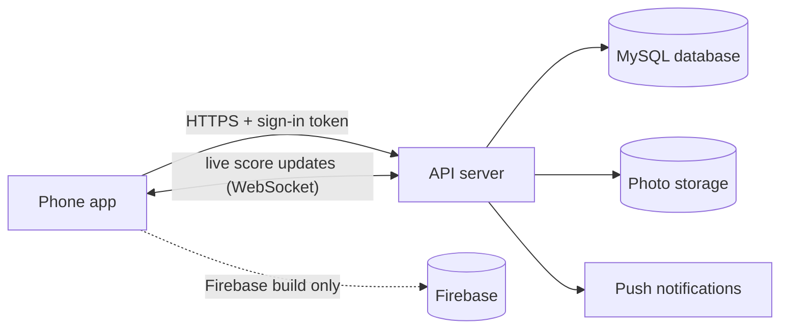
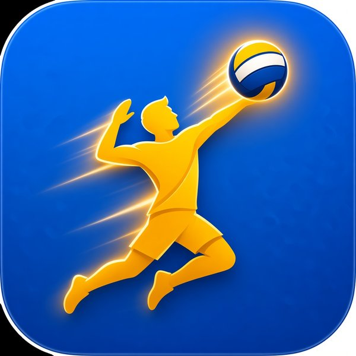

# VolleyLive – the project in one page (well, one file)

> **Status:** 30 October 2026 · current build **1.5.9** (versionCode 54) · Android app for amateur volleyball in India.
> This file explains the whole project in plain language. The detailed, technical chapters are in
> [`docs/guide/`](guide/README.md) (written for 1.5.7, still accurate except where this file says 1.5.8 / 1.5.9 changed something).
> No passwords, keys, tokens, phone numbers or personal data appear in this file.

---

## 1. What VolleyLive is

VolleyLive is a phone app that makes casual and club volleyball feel like a "real" sport:

- **Score a match live** from the side of the court – one tap per rally.
- **Everyone else watches the score change in real time** on their own phones.
- **Teams, stats, rankings and match photos** are kept automatically.
- Teams can **challenge** each other and organisers can run small **tournaments**.
- A built-in helper, **Ask VolleyLive**, answers questions about the rules and about your own games.
- It speaks **English and Hindi**, and it has two looks – a bright **Day** theme and a dark **Night** theme
  that switches by itself in the evening.

The idea in one sentence: *the scoreboard, team sheet and trophy cabinet of your local volleyball court, in your pocket.*

---

## 2. What you can do with it (as of 1.5.9)

### Sign up with your mobile number
Type your 10-digit mobile number, receive a **6-digit code (OTP)** by SMS, type it in – done. First time only, you
accept the Terms (points are just for fun, results must be fair) and fill in your name, role, city and date of birth.
Nobody else can ever see your mobile number.

### Teams by mobile number
Create a team, give it a name and colour, and **add teammates by their mobile number**. They get an invite they can
accept or decline. A team needs at least 6 players and can have up to 12 (at most 6 "starters", the rest are
substitutes – this limit was tightened in 1.5.9).

### Matches and live scoring (with Undo)
- The centre **+** button starts a new match in **3 steps: Teams → Rules → Start**.
- Rules can be **Indoor** (best of 5, sets to 25), **Beach** (best of 3, sets to 21) or your own **Custom** rules.
- During the game the scorer **taps a player** to give that player and their team the point, or **taps the team's
  half** for a team-only point (for example an opponent's mistake).
- **Undo** takes back the last point if you tapped the wrong thing. Once the winning point is in, the match is final.
- Timeouts, substitutions, switching sides, serve and rotation are all tracked.
- No signal? Points are **saved on the phone** and sent when the network comes back.
- After the match: **Player of the Match** is picked automatically (most points), and the **other team's captain
  confirms** the result. Only confirmed results count for rankings. Suspiciously short games are flagged for an admin.

### Tournaments
Three formats: **Knockout** (lose and you're out, with automatic byes), **League** (everyone plays everyone; 3 points
for a 3-0 or 3-1 win, 2 for 3-2, 1 for a 2-3 loss) and **Groups + knockout** (up to 32 teams, seeded or random draw).
Each tournament has a table, a bracket and a fixtures list.

### Challenges
A captain can **challenge another team** – pick a day, time, place and add a message. If the other captain accepts,
the match is created automatically.

### Ask VolleyLive (the chatbot)
Ask things like *"How many points win a set?"* or *"What's my next match?"*. It:
- answers rules and how-to questions **only from VolleyLive's own help and rule notes**, and shows its sources
  (this is called "RAG" – it looks things up before answering instead of guessing);
- shows your stats, teams, matches, live scores, tournament tables, challenges and the leaderboard as neat cards;
- is **read-only** – it can never change, delete or score anything;
- **never reveals private details** like phone numbers, and ignores tricks hidden in questions;
- works in English, Hindi and "Hinglish".

### Home and the daily quote
Home greets you by name depending on the time of day ("Good morning", "Good evening", "Late game?"), shows any match
that's live right now, a **Fact / Quote of the day** (tap for the next one – it resets each day at midnight IST),
quick buttons, your rank, invites and upcoming games. The **Map** tab shows courts and games near you.

### Profile, About, feedback and rating
Your profile shows your career stats, recent form, teams, match history and photo memories, plus a **points wallet**
(in-app points only – no money value; +100 bonus for every 5 confirmed wins). Settings has Appearance, Language, the
**Help Center** (search + FAQ + contact us), **Send feedback** (stars + comment), **Rate VolleyLive** (Google Play's
rating sheet once the app is published) and **About** (version, licences, privacy policy draft).

### English / Hindi and Day / Night
- Switch language any time; every screen, the Help Center and Ask follow.
- **Day ("Sunday Court")**: warm cream background, Court orange, Ball yellow.
- **Night ("Floodlight")**: deep navy with a neon "Volt" green.
- **Auto** mode uses Day from 6 AM to 6 PM and Night from 6 PM to 6 AM, with a short "sunset → floodlights"
  animation (it never interrupts a live score).

---

## 3. How it's built (tech stack and architecture)

| Part | What it uses |
|---|---|
| The app | **Expo / React Native** (one codebase, Android first), TypeScript, expo-router screens, i18next for EN/HI, react-native-maps, reanimated animations |
| The server | **Node.js + Express**, **MySQL 8** database, WebSocket for live scores, Expo push notifications |
| Alternative backend | **Firebase** (Firestore database + Storage + phone sign-in) protected by security rules |
| Demo mode | everything stored on the phone with sample data, for testing |
| Shared brain | the scoring, rules, fairness and ranking logic lives in one shared folder (`src/core`) used by **both** the app and the server, so they always agree |

How a point travels: the scorer taps → the phone saves it immediately → sends it to the server → the server checks
the scorer is allowed, replays the match to make sure the score is right, saves it → every viewer's phone gets the
new score within a moment.

More detail: [Architecture](guide/03-architecture.md), [Database](guide/05-database.md), [API](guide/06-api.md).

---

## 4. Version history (1.2.0 → 1.5.9)

| Version | When (2026) | What changed, in plain words |
|---|---|---|
| 1.2.0 | 11 Oct | New "Paytm-style" navy look (later replaced). |
| 1.2.1 | 11 Oct | Smoother animations, Player of the Match rules, safer match creation. |
| 1.3.0 – 1.3.1 | 11 Oct | First MySQL server version alongside the app; rate limits against spam. |
| 1.3.2 – 1.3.3 | 11 Oct | 3-step New match, tap-a-player scoring, new live match screen, photo gallery, team-half tap for team points, Undo fixes. |
| 1.3.4 – 1.3.6 | 11 Oct | Offline indicator, wallet breakdown, registration fields (name, date of birth, email, pincode), "Exact 6 / Custom" team size. |
| 1.3.7 – 1.3.9 | 11 Oct | Fair-play rules, captain confirmation, privacy policy draft, licences page, more Hindi. |
| 1.4.0 – 1.4.10 | 11 – 12 Oct | Anti-fraud and match lifecycle rules, abandoning a match (with review), fixing matches nobody could confirm. |
| 1.4.11 – 1.4.18 | 12 – 13 Oct | Many fixes from testing, accessibility, keyboard and footer fixes, more Hindi. |
| 1.4.19 | 13 Oct | Tournament admin permissions and the **Help Center**. |
| 1.4.20 – 1.4.21 | ~13 – 14 Oct | **Ask VolleyLive** first version (answers from help and rules). |
| 1.4.22 – 1.4.24 | ~14 – 15 Oct | The new **Day / Night design** rebuilt across the app; Night contrast fixes; Hindi Ask. |
| 1.4.25 | 15 Oct | **Brighter colours** ("the colour is too much dark, make it brighter"). |
| 1.4.26 – 1.4.28 | to 21 Oct | First **Spiker** app icon and splash; **Groups + knockout** tournaments; bracket fixes. |
| 1.5.0 | after 21 Oct | **Ask with your own data** (stats, matches, tables…) shown as cards; strict read-only. |
| 1.5.1 – 1.5.7 | to 23 Oct | Ask hardening: hiding phone numbers and emails, private history, admin content, audit; many fixes. |
| **1.5.8** | 29 – 30 Oct | **Bold Spiker** app icon and in-app logo; a match created by an outsider now needs **both** captains to confirm; stricter rules for silly match settings; rate-limited phone look-ups; a proper "page not found" screen; support link now set by configuration. |
| **1.5.9** | 30 Oct | **Privacy fix (F158-3)**: phone numbers moved into private, owner-only storage on the Firebase backend, with a limit on look-ups; team invites no longer reveal who is registered; at most 6 starters per team; timeouts FAQ for Ask; web Back button through New match steps; Hindi "Pinned location"; admin review lists only played matches; daily quote "tap for next" fix. |

Every build from 1.4.1 has its own notes in [`docs/qa/`](qa/) (`RELEASE-<version>.md`).

---

## 5. Design

### The logo – the Bold Spiker
A big glowing **yellow athlete spiking a blue, yellow and white ball**, with motion streaks, on a **blue** background.
It replaced the earlier, simpler "Spiker" icon in 1.5.8. How we got there:

1. Ten first ideas (tricolour ball, live pulse, VL monogram, spike, shield, net, **spiker**, play ball, flame, rangoli)
   → the **Spiker** won.
2. Six refreshed options → the "Spiker Refresh" was the top pick because it shows *a person playing, not just a ball*.
3. Akshit picked the bolder version – the **Bold Spiker** – which ships in 1.5.8 and 1.5.9.

Logo colours: brand blue `#0055A4`, yellow `#FFD100`, ink outline `#0B1F44`.

### Colours and themes

| | Day · "Sunday Court" | Night · "Floodlight" |
|---|---|---|
| Background | cream `#FFFAF3` | navy `#1E2A44` |
| Cards | white `#FFFFFF` | `#283654` |
| Text | ink `#2A2452` | `#F4F7FF` |
| Main colour | Court orange `#FF6A13` | Volt green `#C6FF1A` |
| Accent | Ball yellow `#FFC531` | Ultra violet `#8B6CFF` |
| Team A / Team B | `#FF6A13` / `#0B6E6A` | `#FF6B70` / `#2DD4F0` |
| Live / error | `#C81E3A` | `#FF4D6A` |
| Fonts | Baloo 2 + Hind | Teko + Mukta |

All text passes the international readability (contrast) standard in both themes – checked automatically
(272 text pairs, 0 failures in 1.5.9). Full design system: [Design system](guide/11-design-system.md).

---

## 6. How it is tested

Every build goes through the same loop:

1. A separate **Tester** tries everything (in a browser at phone size, Day and Night, English and Hindi) and writes
   numbered findings (High / Medium / Low).
2. The **Developer** fixes each one and adds an automatic test that would have caught it.
3. All automatic test suites must pass, then the build is packaged and checked.
4. The Tester **retests**, then it goes on Akshit's phone and to GitHub.

**1.5.9 results:**

| Check | Result |
|---|---|
| App tests | **2615 / 2615** passed (also repeated in 5 time zones) |
| Server tests | **597 / 597** |
| Firebase security-rule tests | **239 / 239** |
| Ask quality test | **386 / 392 = 98.5 %** (the misses are known edge cases) |
| Colour contrast | 272 checked, **0** failures |
| Tester verdict | **PASS** – no High or Medium problems |

More: [Testing](guide/08-testing.md), [Acceptance checklist](guide/14-acceptance-checklist.md).

---

## 7. Security and privacy (no secrets here)

- **Sign-in** is by SMS code; the server only stores a scrambled (hashed) version of the code, with limits on tries.
- **Your phone number, email, date of birth, pincode and wallet are private** – only you see them. Others can add you
  by number but never see it. Since 1.5.9 this is also true on the Firebase backend.
- **Only the scorer can score**, only the other captain can confirm, and the server re-checks every score itself.
- **Rate limits** stop spam (sign-in codes, look-ups, feedback, Ask, match writes).
- **Ask** never sees or shows private fields, hides phone numbers and emails, and can't change anything.
- **Photos** are only served through short-lived signed links.
- **No secrets in the code:** passwords and keys live only in private server settings or build settings, never in
  GitHub. Before every upload a scan checks for keys, tokens and passwords; the example settings files contain only
  placeholders.
- Points have **no money value**.

More: [Security and privacy](guide/09-security-privacy.md).

---

## 8. Where things stand right now

| Item | State |
|---|---|
| Build | **1.5.9 (versionCode 54)**, final PASS from the Tester |
| Akshit's phone | **1.5.9 installed** (upgraded from 1.4.28 on 30 Oct) and starts without crashing |
| GitHub | [github.com/Akshitcc/vollyBall](https://github.com/Akshitcc/vollyBall) – main is at commit [`aea05de`](https://github.com/Akshitcc/vollyBall/commit/aea05de3c14b06f348a371c17e89a20789fb6de8) "VolleyLive 1.5.9: privacy fix (F158-3), Bold Spiker icon, 1.5.8 fixes" (this summary is added in the commit after it) |
| Production | **Nothing is live yet.** The app is a test build; there is no public server or Play Store listing |

---

## 9. Known small bugs (Low) in 1.5.9

| ID | What it is | Who is affected |
|---|---|---|
| **F159-1** | Adding several new invite numbers to a team in **one** request can keep getting "too many requests" forever, because the limit charges per number and doesn't refund. | Only scripts / other API clients – the app adds one number at a time. |
| **F159-2** | On the **Firebase** backend, a 7th player accepting an invite joins as a 7th starter instead of a substitute. | Only Firebase builds (the real build uses the API server). |
| **F159-3** | The packaging safety check misses some unusual ways of writing a port number in a file. | Developer tooling only. |
| **F159-4** | The admin **Approve** button acts on one tap, without the "are you sure?" that Void and Repair have. | Admins. |
| F159-5 – F159-7 | **Not found in the Tester's reports** available to us – the 1.5.9 report lists F159-1 to F159-4 only. Small notes from the same pass: the repair card's "Why:" line is blank, and the Groups "Q" mark shows before any match is played. | – |
| V1426-3 | Firebase rules can't enforce the tournament fixture lock (too many look-ups per request); the API server does. | Only Firebase builds. |

---

## 10. Decisions waiting for Akshit

| # | Decision | Why it matters |
|---|---|---|
| 1 | **Approve the production database updates 0024 – 0029** (tournament groups, match-create protection, Ask content / history / audit, "both captains confirm") and the **Firebase rules deploy** together with a 1.5.9 Firebase app and the private-profile data move (dry run first) | needed before going live; all are add-only changes, but back up first |
| 2 | **AI provider and key** for Ask (OpenAI, Gemini or Anthropic, or keep the free built-in mode) | Ask currently runs in a safe built-in "mock" mode; real AI has never been tested live |
| 3 | **Support website address** (`EXPO_PUBLIC_SUPPORT_URL`), plus support email / WhatsApp | the Help Center's "support website" button stays hidden until it is set |
| 4 | **FIVB rules licence** | our rule notes are in our own words and link to FIVB; confirm that's acceptable |
| 5 | **Hindi review** by a native speaker | some Hindi text is marked "needs review" |
| 6 | **In-app account deletion** | Google Play requires a way to delete your account from the app; the server supports it, the app has no button yet |
| 7 | Open product calls | abandon policy (now "review", interim); may a player be in two registered teams; phone-number-looking team names; defence against a fake "opposing captain" account (C130-1); should position / city also be private; should a signed-in theme change also change the device default (F158-13); the proposed brighter Night green |

Launch also needs: a Google Play account and signing key, hosting for the server and database, SMS sender
registration for India (DLT), a Google Maps key, admin accounts, a support email, the privacy policy reviewed for
India's data-protection law (DPDP) and the Play data-safety form. See [Roadmap](guide/10-roadmap-and-open-items.md).

---

## 11. Roadmap (what's next)

1. **Fix the small bugs** F159-1 to F159-4 (+ the two cosmetic notes).
2. **Launch prep**: decisions above, production server, Play Store internal testing, then public release.
3. **In-app account deletion** button.
4. **Real AI for Ask** once a provider is chosen and tested.
5. **Notifications inbox**, **onboarding** screens and **rankings** with periods, team rankings and a podium.
6. **Viewer reactions** (the buttons exist, but nothing is sent yet).
7. Possibly the **brighter Night green**, an **iOS** version, and live video later.

---

## 12. The detailed guide

| Chapter | |
|---|---|
| [Index](guide/README.md) | start here |
| [1 · Overview](guide/01-overview.md) | features, personas, history |
| [2 · User guide](guide/02-user-guide.md) | every screen, step by step |
| [3 · Architecture](guide/03-architecture.md) | how the pieces fit, with diagrams |
| [4 · Ask chatbot](guide/04-chatbot.md) | how Ask finds answers and stays safe |
| [5 · Database](guide/05-database.md) | tables and migrations |
| [6 · API](guide/06-api.md) | every server endpoint |
| [7 · Setup and build](guide/07-setup-and-build.md) | running and building it |
| [8 · Testing](guide/08-testing.md) | test suites and QA process |
| [9 · Security and privacy](guide/09-security-privacy.md) | how data is protected |
| [10 · Roadmap and open items](guide/10-roadmap-and-open-items.md) | decisions and gaps |
| [11 · Design system](guide/11-design-system.md) | colours, fonts, logo, icons |
| [12 · Glossary](guide/12-glossary.md) | words explained |
| [13 · FAQ](guide/13-faq.md) | common questions |
| [14 · Acceptance checklist](guide/14-acceptance-checklist.md) | how to accept a build |
| [Full PDF](guide/VolleyLive-Documentation.pdf) | all chapters in one file |

*The guide was written for 1.5.7; 1.5.8 and 1.5.9 changes are summarised in sections 4 and 9 above and in
`docs/qa/RELEASE-1.5.8.md` / `RELEASE-1.5.9.md`.*
