# 2. User guide

This guide walks through every screen of VolleyLive 1.5.7 in the order a new player meets them.
Screen names in **bold** match the app's English labels (Hindi labels are in `src/i18n/locales/hi.ts`).
Screenshots use the app's **sample data** (made-up names), never real people.

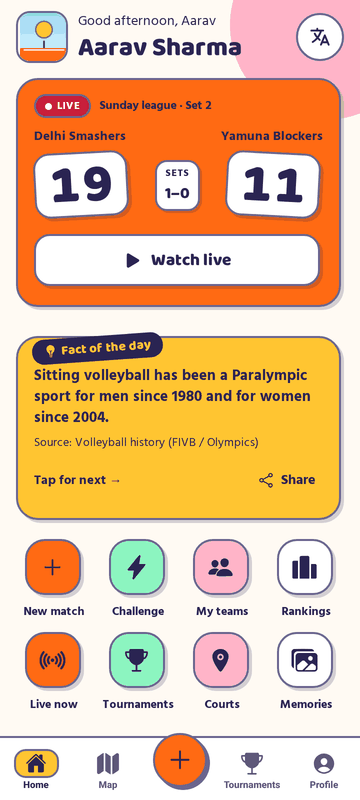
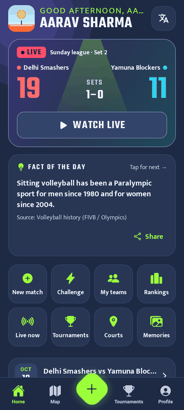
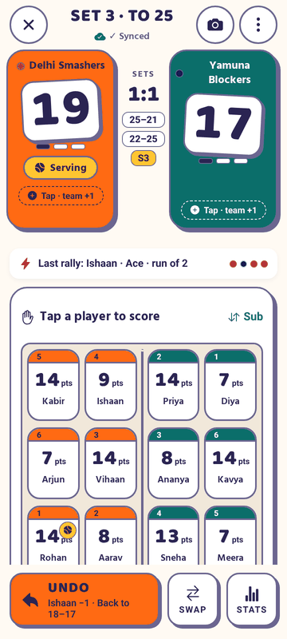

*Home (Day), Home (Night) and Live scoring (Day) – captured on the 1.4.26 build with demo data.*

---

## 2.1 Sign-up and sign-in (mobile number + OTP)

1. Open the app. The **Login** screen shows *"Welcome! 👋 – Log in with your mobile number to score matches and
   climb the rankings."* and the tagline *"Score. Track. Play anywhere."* An **English / हिन्दी** switch sits at the top.
2. Type your **10-digit Indian mobile number** (the `+91` prefix is fixed). Invalid numbers show
   *"Enter a valid 10-digit mobile number"*. Tap **Send OTP**.
3. The **Enter the code** screen shows *"Sent to …"* with a **Change** link. Type the **6-digit code**.
   **Verify & continue** stays disabled until all 6 digits are entered. **Resend code** unlocks after the timer
   (*"Resend in …"*).
4. First sign-in only:
   - **Terms & Conditions** – tick *"I have read and accept these Terms & Conditions"* and tap **Accept and continue**.
     The terms cover: points have no money value, fair play (a result counts only after the opposing captain confirms),
     your data, conduct, and changes. When the terms change, the app asks you to accept the new version before you can
     make changes again (every write on the server checks this).
   - **Profile setup** – name, playing role / position, city and pincode, date of birth (a scroll picker) and an
     optional photo. Players below the minimum age (`MIN_AGE`, 10 by default) cannot sign up.
5. You land on **Home**.

| Backend | How the code is sent |
|---|---|
| API server (production) | The server sends an SMS OTP through the configured provider (MSG91 in production; a console provider for development). OTP lifetime, attempts, resend gap and per-hour limits are server settings. |
| Firebase direct | Firebase phone auth (a "security check" screen may appear). |
| Demo | No SMS. A banner says *"Demo mode … Use any number; the code is 123456."* Data stays on the phone. |

**Signing out:** Profile → **Sign out**. The server session is revoked (`POST /auth/logout`).

## 2.2 Profile and settings

The **Profile** tab shows:

- your name, role and city, and an **Edit profile** button;
- **My details (only you can see these)** – pincode and date of birth / age;
- the **rank card** (rank among all players and points to the next place);
- **Career stats** – Matches, Wins, Win %, Points, Spikes, Blocks, Aces, Tips, Losses;
- **Recent form** (W / L, latest first);
- **My teams** (with *· Captain* where you captain), **New team**;
- **Match history** and **Memories** (photos from your matches);
- a note when finished matches *"don't count yet (waiting for confirmation or review, or over a limit)"*;
- **Settings** and, for admins only, an **Admin** section (Review flagged, Facts, Feedback).

### Appearance (themes)

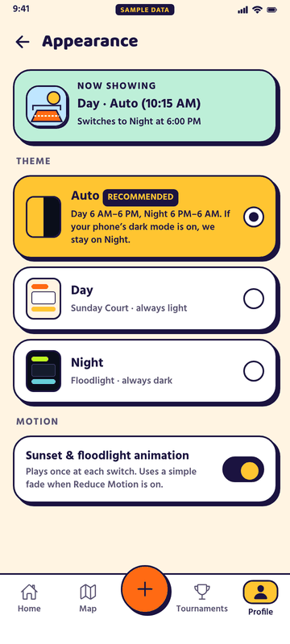

Profile → Settings → **Appearance** has three radio cards and one switch:

| Option | Behaviour |
|---|---|
| **Auto** (recommended) | **Day 06:00 – 17:59, Night 18:00 – 05:59**, by the phone's clock. Auto is purely time-based in 1.5.7 (this was Akshit's choice; the design spec had "the phone's dark mode wins"). |
| **Day** | "Sunday Court" – always light. |
| **Night** | "Floodlight" – always dark. |
| **Sunset & floodlight animation** | On: a 1.4-second *Sunset → Floodlight* animation plays once at each switch. Off, or with the system *Reduce Motion* setting: a short fade. |

During live scoring the switch never covers the score: it waits for the end of the rally and then crossfades.
See [11 – Design system](11-design-system.md) for colours and the animation storyboard.

### Language

Profile → Settings → **Language**: **English** or **हिन्दी**. The whole app, the Help Center and the Ask assistant
switch language. Ask also understands romanised Hindi ("mera score kya hai"). The Hindi copy still needs a
native-speaker review (see [10](10-roadmap-and-open-items.md)).

### Wallet

Profile → **Points wallet** shows the balance (*"In-app points only. They have no money value."*), points from
matches, the **win bonus** (+100 for every 5 counted wins), *"N more counted wins to the next bonus"*, counted
matches / wins, matches waiting for the other captain or flagged for review, and a **Points history**.

## 2.3 Teams

- **Create a team:** Profile → **New team** (or Home → **My teams**). Enter a **team name** and pick a **team colour**.
  You become the **captain**. Add players **by mobile number**; a number that belongs to a VolleyLive user shows
  *"On VolleyLive"*.
- **Invites:** an added player gets an invite (shown on Home and as a push notification) and can **Accept** or
  **Decline**. Only accepted, registered players count.
- **Team page:** stats (played, won, lost, win %), roster with captain tag, **Challenge** and **Start match** buttons.
  Unconfirmed results are not counted; the page says *"N result(s) waiting for the other captain"*.
- **Leave a team:** a player can leave; the captain manages the roster.
- **Size:** at least **6** players are needed to play; a team can have up to **12** (6 on court + 6 substitutes).
- Phone numbers of other players are never shown to you.

## 2.4 New match and live scoring

### New match (3 steps)

Tap the centre **+** button. A stepper shows *"Step n of 3"*:

1. **Teams** – for Team A and Team B either **Pick a registered team** (search by name) or **Add players by number**
   (a one-off side built from registered players, not saved as a team). Pick a **colour**, a **captain** and the
   **first serve**. **Team size:** *Exact 6* (for a registered team of 7 or more you pick the 6 who play – the captain
   always plays) or *Custom (6–12)* (6 on court, the rest on the bench). A player cannot be in both teams.
   The **Next: Rules** button explains what is missing ("needs 6 per team", "a player is in both teams", …).
2. **Rules** – **Indoor** (best of 5, sets to 25, deciding set to 15, win by 2, 2 timeouts per set, switch sides at
   8 in the deciding set), **Beach** (best of 3, sets to 21, deciding set to 15, win by 2, 1 timeout per set, switch
   sides every 7 points, every 5 in the deciding set) or **Custom** (change any value; this marks the rules custom).
3. **Start** – *"Ready to start?"* summary: rules, when (**▶ Start now** or **🗓 Schedule**), court / location,
   scorer (*"You"*), captains, players, first serve, optional **Match title**. Tap **Start match** or **Schedule match**.

> Design note: the spec mockups show a 4-step flow (teams → add players by shirt number → rules → toss). 1.5.7 ships
> the 3-step flow above.

### Live scoring (scorer only)

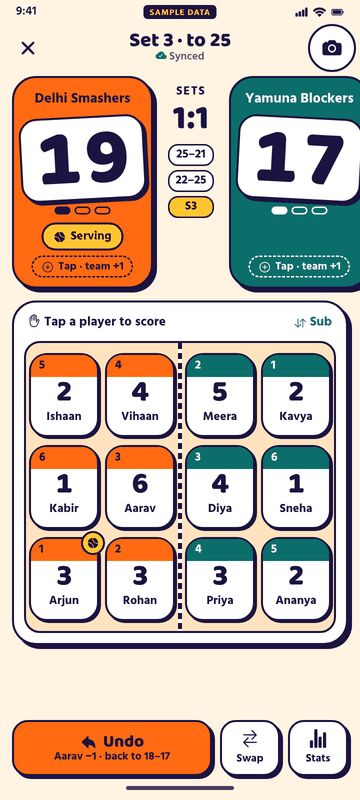
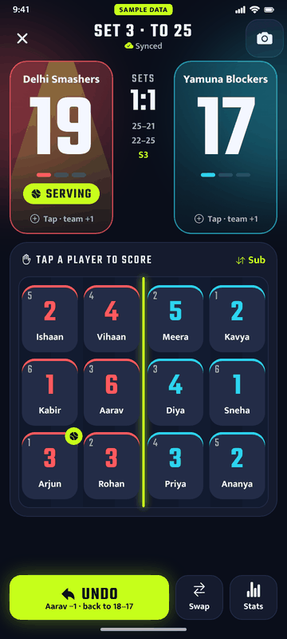

| Action | Result |
|---|---|
| **Tap a player tile** | That player gets the point **and** their team gets the point (*"One tap gives … and … the point."*). After a team point you can optionally pick *who scored* and the shot type (spike, block, ace, tip). |
| **Tap a team's half / panel** | Team point only (*"Opponent error? Tap the team's half for a team point only."*). |
| **UNDO** | Removes the last rally (see 2.5). |
| **SWAP** | Switch sides (🔄). The app also prompts at the rule's switch points. |
| **Timeout (n)** | Records a timeout for a team; *"No timeouts left"* when used up. |
| **Sub** | Substitution: pick who goes off (on court) and who comes on (bench). |
| **Court & rotation** | Shows the 6 positions, server and rotation (rotation advances on side-out). |
| **STATS / Point-by-point** | Per-player points and the rally timeline. |
| **📷** | Take or pick match photos (up to 50 per match, 10 per batch, 10 MB each). |
| **⋮ Match options** | Share live score, Abandon match, … |

The header shows the set, *SET POINT* / *MATCH POINT*, sets won, *SERVING* and the sync state:
**✓ Synced**, **Syncing…**, **⚠ Offline – saved on phone** (rallies wait on the phone and are sent later) or
**✕ Not saved**. Only the assigned scorer can score (*"Only the assigned scorer can score this match. You can follow
it live instead."*). The scorer can hand scoring over to another eligible person.

**End of match.** The winning rally ends the match (*"… win!"*). The result screen offers **Share the win** and
**Match summary & photos**. Then:

1. **Player of the Match** – auto-picked: the most points credited to a player, from either team (team points
   don't count; ties are broken by the deciding set, …). The scorer can choose another player and confirms.
2. **Result verification** – the **opposing captain confirms** or **rejects** (with an optional reason). Only a
   confirmed, unflagged result counts for rankings and the wallet.
3. **Anti-fraud:** matches shorter than 10 minutes are flagged; at most 3 counted matches per player per IST day and 2
   per team pair per IST week. Flagged matches wait for an **admin review** (approve clears the flag; void never counts).

**Abandon.** ⋮ → **Abandon match**. A match with no rally is simply abandoned (or deleted by its creator). After the
first rally the current policy is **'review'** (interim, pending Akshit's decision): the abandon is recorded and
waits for review, and the opposing captain can **Report** it. Full rules: `docs/LIFECYCLE.md`.

### Following a match live (everyone else)

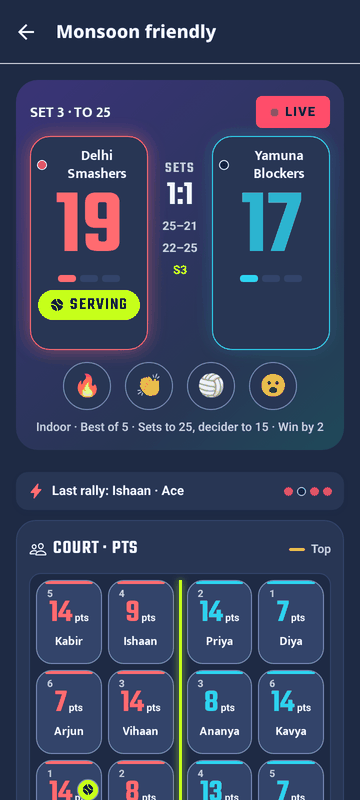
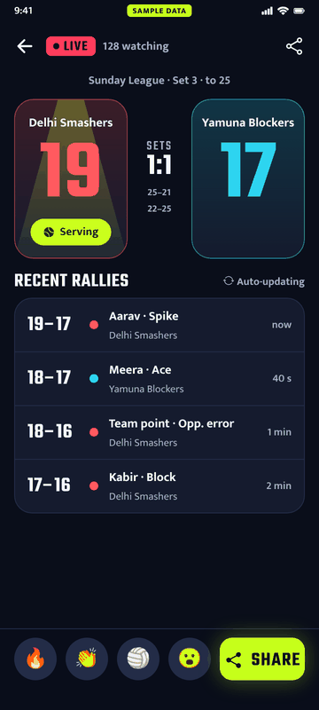

Open a live match from Home (**Watch live**), the map or a tournament. The read-only scoreboard updates after every
saved rally. Below it are the **recent rallies** (auto-updating), the timeline and stats, and **Share**.
The reaction buttons are shown but are UI only in 1.5.7 (nothing is sent).

## 2.5 Undo

- **UNDO** (sticky at the bottom of the scoring screen) removes the **last rally**: the team point and, if one was
  credited, the player's point. The button shows what it will undo, e.g. *"Aarav −1 · Back to 18-17"*.
- After undo a toast says *"Point undone"*. With nothing to undo: *"Nothing to undo yet"*.
- **Once the winning rally is in, the match is final everywhere:** undo is refused (*"Match over: the score is
  final"*). After the Player of the Match is set: *"Match closed: Player of the Match is set"*. Only a credit on one of
  the last 3 rallies and the captain / admin fields can still change.
- Undoing back to 0 rallies does **not** make a played match deletable again.

## 2.6 Challenges

1. Only a **team captain** can challenge (*"Only a team captain can send challenges."*). Start from Home →
   **Challenge** or from another team's page.
2. Choose **which of your teams** sends it, **find the team** to challenge (search by name), pick the **day**,
   **time** and **place**, and add an optional **message**. Tap **Send challenge**. A team cannot challenge itself, and
   both teams need at least 6 players.
3. The other captain gets a notification and the challenge on Home, and can **Accept** or **Decline**.
4. When accepted, a playable match is created. The **accepting captain is the scorer**; the challenger's captain
   confirms the result. The challenge stays linked to that match only.
5. Challenges can be cancelled (deleted) by the sender before they are used.

## 2.7 Tournaments

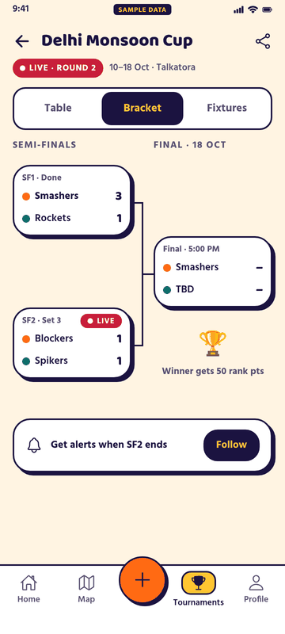

Tournaments tab → **Organise / New tournament**:

| Field | Values |
|---|---|
| Name | e.g. "Diwali Cup 2026" |
| Format | **🥇 Knockout** – lose and you are out; byes go to top seeds automatically, a play-in round brings the field to a power of two. **📊 League (round robin)** – every team plays every other; win 3-0 / 3-1 = 3 pts, 3-2 = 2 pts, lose 2-3 = 1 pt. **Groups + knockout** – round robin in groups (A–H, up to 8 groups), top teams go to a knockout bracket (A1 v B2, B1 v A2, …); needs at least 4 teams. |
| Draw (groups) | **Seeded** (dealt A, B, C, D, D, C, B, A… so top seeds are apart) or **Random**; **Draw again**; a preview shows group + knockout match counts and byes. |
| Starts in / Duration | e.g. 1, 2 or 3 days |
| Teams | up to **32** registered teams with at least 6 players; the order is the seeding |
| Venue | a court / location |

Tap **Create tournament & fixtures**. The tournament page has **Table**, **Bracket** and **Fixtures** tabs; matches
are played and scored like any other match and results feed the table. Only the organiser (and admins) can change a
tournament. A champion is shown when the final is decided.

## 2.8 Home (greeting, Fact / Quote of the day, map)

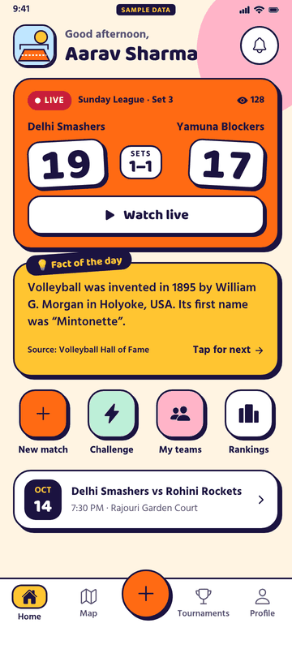
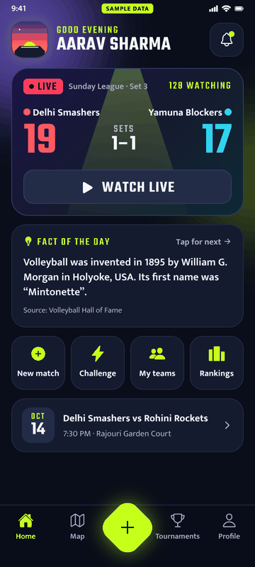
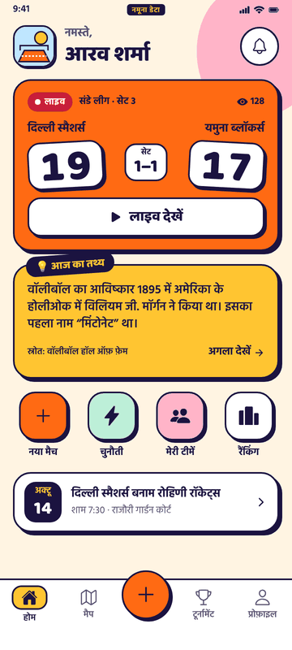

- **Greeting** by the hour: *Good morning* (05–11), *Good afternoon* (12–16), *Good evening* (17–20) and
  *"Late game, …?"* at night, with your name.
- **Live hero** – a match that is live now, with **Watch live**.
- **Fact / Quote of the day** card – *"Tap for next"* shows the next item; **Share**; the source is shown. Admins
  manage the items.
- **Quick actions:** New match, Challenge, My teams, Rankings, Live now, Tournaments, Courts (opens the Map tab),
  Memories.
- **Ask VolleyLive** entry card, your **rank card**, team **invites** and **challenges** to answer, the live
  carousel and **upcoming** matches.

### Map

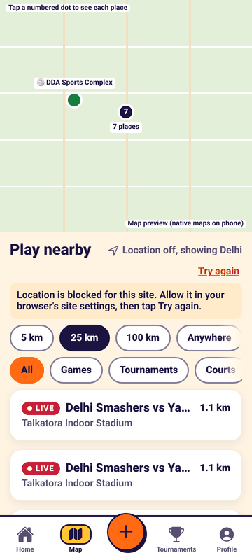

The **Map** tab shows courts and live / upcoming games near you, with distance chips (5 km, 25 km, 100 km, All) and
filters (Games, Tournaments, Courts). The **Play nearby** list works without location permission (it then explains
how to allow it). **Courts → Add court** adds a court with a location pin. Locations are only stored when you share them.

## 2.9 The Ask chatbot (Ask VolleyLive)

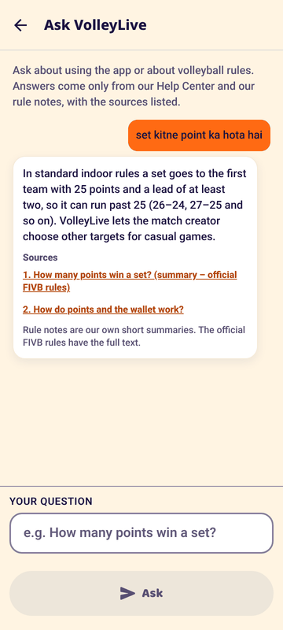

Open from the Home card or Settings → **Ask VolleyLive**. Type a question (*"e.g. How many points win a set?"*)
and tap **Ask**.

- **Rules and how-to questions** are answered from the Help Center FAQ, the app guides and VolleyLive's own rule
  notes, **with the sources listed**.
- **Questions about your own data** use read-only tools and show **cards**: *"my stats"*, *"my teams"*, *"my next
  match"*, *"live score of …"*, *"table of … cup"*, *"fixtures"*, *"my challenges"*, *"top players"*, another
  player's public stats, a team's roster.
- **It never changes anything.** *"Delete my match"* or *"add a point"* is refused with a pointer to the right screen.
- **It never reveals private data** (phone numbers, emails, wallet, date of birth …) and ignores instructions
  hidden in questions or data.
- **History:** your recent questions are kept for you only; **Clear** deletes them.
- EN, HI and romanised Hindi. Details: [04 – Chatbot](04-chatbot.md).

## 2.10 Help, feedback, rating and About

| Screen | What it does |
|---|---|
| **Help Center** | Search (*"Try 'points' or 'team'"*), topic tiles (Registration, Teams, New match, Scoring, Player of the Match, Wallet and points, …), FAQ accordion, *"Still need help?"* → **Contact us**. |
| **Contact us / My messages** | Create a support ticket with an optional screenshot and see replies. Email / WhatsApp / support-website buttons appear only when configured. |
| **Send feedback** | 1–5 stars and optional text. *"Feedback is never rewarded with points or badges."* Rate-limited. |
| **Rate VolleyLive** | Opens Google Play's in-app review sheet in the Play build (*"Ratings work once VolleyLive is published on Google Play."*). An optional pre-prompt (*"Enjoying VolleyLive?"*) is off by default. |
| **About** | Version, backend (Demo / API server / Firebase), API host, links to Licences, Privacy (DRAFT) and Terms. Demo builds show demo-only testing tools. |
| **Licences** | Open-source and font licences, generated at build time. |

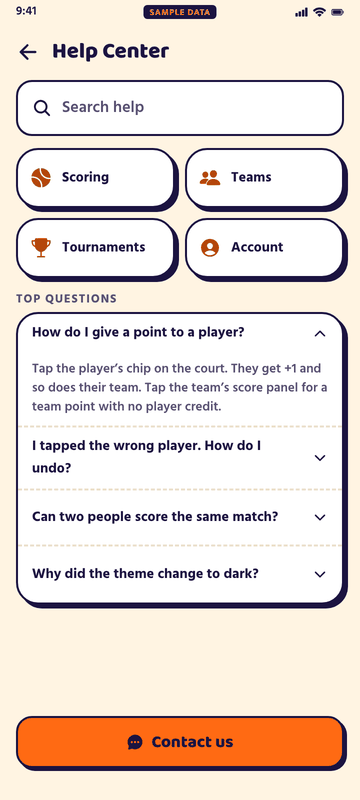
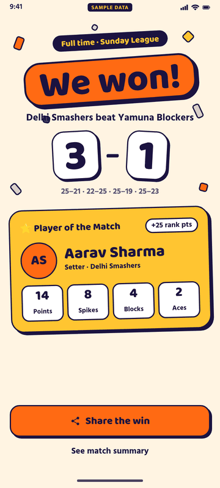

