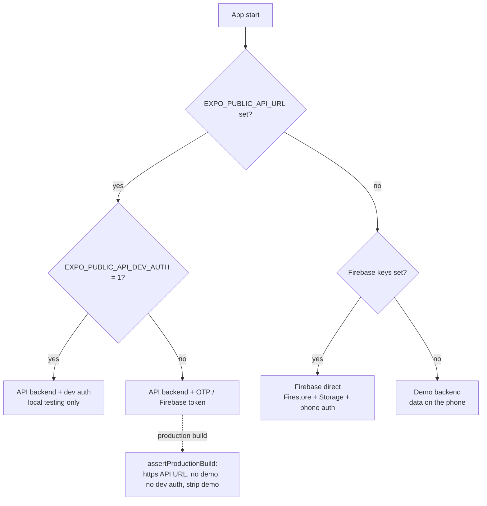
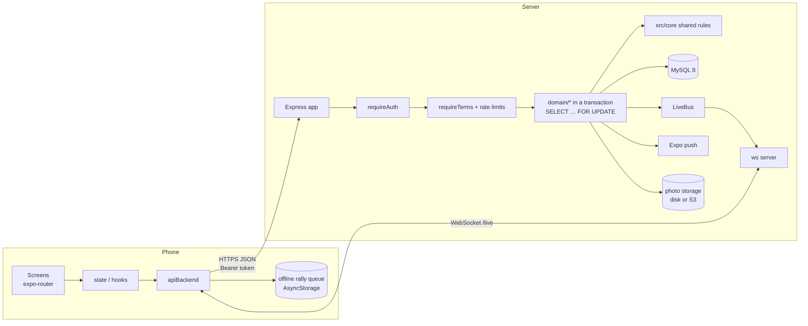
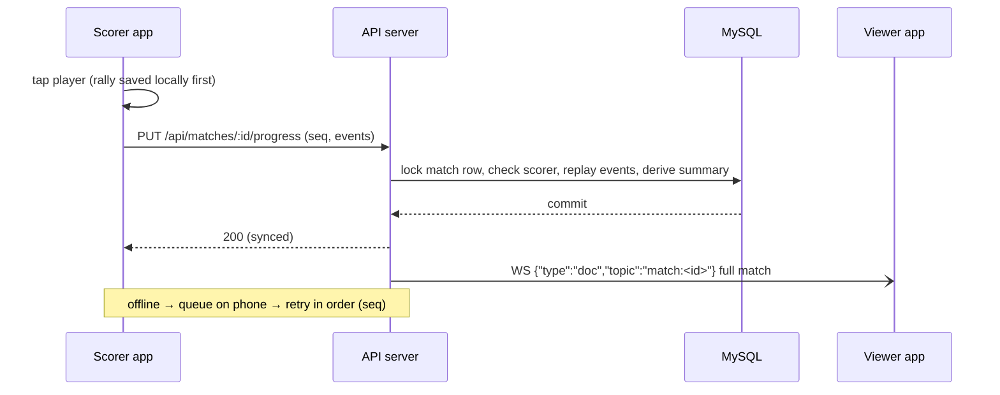
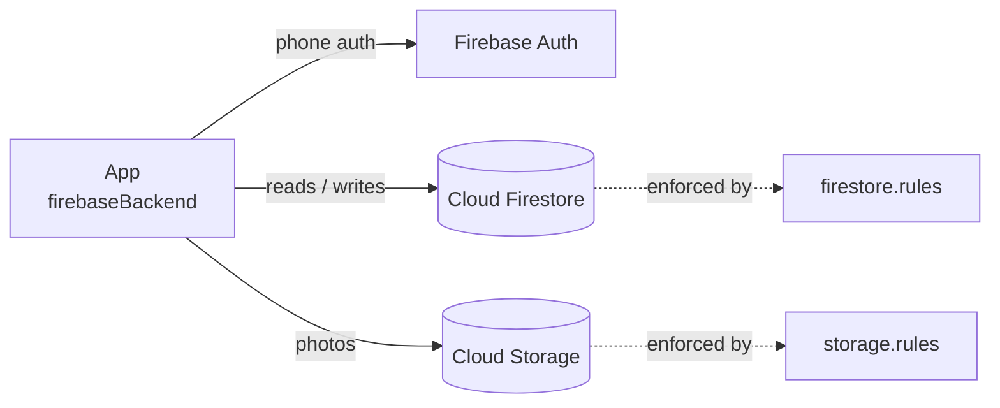

# 3. Architecture

## 3.1 Technology stack

| Layer | Technology (1.5.7) |
|---|---|
| App framework | **Expo SDK 57**, **React Native 0.86.3**, TypeScript, file-based routing with **expo-router** |
| UI | Own Day/Night component kit (`DayNightKit`, `DNKit`, `ui.tsx`), **react-native-reanimated 4** (animations), react-native-svg, expo-linear-gradient |
| i18n | **i18next** with English (`en.ts`) and Hindi (`hi.ts`) |
| Maps / location | **react-native-maps**, expo-location |
| Media | expo-image-picker, in-app match camera, a photo upload queue |
| Notifications | expo-notifications (Expo push service) |
| Local storage | AsyncStorage (session, settings, offline rally queue, demo data) |
| Backend option A | **Node ≥ 20, Express 4, Knex 3, MySQL 8 (mysql2)**, `ws` WebSocket, `zod` validation, `firebase-admin` (only to verify Firebase ID tokens), optional Redis |
| Backend option B | **Firebase JS SDK 13**: Firestore, Storage, phone auth, protected by `firestore.rules` / `storage.rules` |
| Backend option C | **Demo backend** – in-memory + AsyncStorage on the phone, seeded sample data |
| Shared logic | `src/core/*` – pure TypeScript used by the app **and** the server (scoring, rotation, rules, lifecycle, anti-fraud, ranking, Ask) |
| Tests | Jest (app), `node --test` (server), Firebase emulator + Jest (rules), Ask eval runner, contrast scan |
| Build | `expo prebuild` + Gradle locally, or **EAS Build** (`development`, `preview` = APK, `production` = AAB) |

## 3.2 Repository layout

```
volleylive/
├─ app.config.ts            Expo config: name, version, versionCode, icons, splash, plugins, env checks
├─ eas.json                 EAS build profiles (development / preview / production)
├─ assets/                  icon, adaptive icon, splash, notification icon, fonts
├─ src/
│  ├─ app/                  screens (expo-router)
│  │  ├─ (tabs)/            index (Home), map, score (+ centre button), tournaments, profile
│  │  ├─ match/             new.tsx, [id]/index.tsx (detail / viewer), [id]/score.tsx (scorer)
│  │  ├─ team/ challenge/ tournament/ court/      new + detail screens
│  │  ├─ login, terms, setup-profile, edit-profile, appearance, ask, help, contact, feedback,
│  │  │  about, licenses, privacy, terms-view, wallet, rankings, memories, teams, courts
│  │  └─ admin-review, admin-daily, admin-feedback   admin-only screens
│  ├─ components/           LiveScoring, LineupPicker, TeamBuilder, RulesEditor, Potm, RewardScreen,
│  │                        DailyCard, HomeGreeting, MiniCourt, PhotoGallery, DialogHost, ask/ …
│  ├─ core/                 shared domain logic (see 3.5) and core/ask (agent, tools, intents, cards, guides)
│  ├─ services/             config.ts (backend choice), backend/ (api, firebase, demo), session, notifications,
│  │                        localScore (offline queue), photoQueue, location, share, review, supportContact
│  ├─ state/                AuthContext, hooks, toasts, dialogs, rankings, memories
│  ├─ theme/                tokens.ts, themes.ts, resolve.ts, ThemeProvider, ThemeTransition, fonts
│  ├─ i18n/                 i18next setup, locales/en.ts, locales/hi.ts, LanguageGate
│  └─ generated/            licences.json (generated)
├─ server/                  the API server (see below)
├─ rules-tests/             Firestore / Storage rules tests (emulator)
├─ firestore.rules  storage.rules  firestore.indexes.json  firebase.json
├─ functions/               old Cloud Functions (ported into the server's domain code)
├─ scripts/                 check-strip, licences, lifecycle doc, abandon policy, contrast scan, icons
└─ docs/                    DEPLOY, KNOWN-GAPS, LIFECYCLE, db-schema, privacy draft, qa/, guide/ (this guide)
```

```
server/
├─ src/
│  ├─ index.ts  app.ts      start-up, Express app, security headers, CORS, error mapping
│  ├─ config.ts             reads and checks every env var (refuses unsafe production settings)
│  ├─ routes/               auth.ts (/auth), api.ts (/api), handler.ts
│  ├─ auth/                 middleware (Bearer check), verifier (session / firebase / dev), otp/ providers
│  ├─ domain/               users, teams, matches, challenges, tournaments, courts, photos, rankings,
│  │                        feedback, support, terms, ask, schemas (zod)
│  ├─ ask/                  host.ts (viewer-scoped tool host), providers.ts (mock / openai / gemini / anthropic)
│  ├─ live/                 bus.ts (LiveBus), ws.ts (WebSocket /live)
│  ├─ db/                   knex, migrate (checksums), seed, rollback/
│  ├─ storage/              photoStorage (local disk, signed URLs), s3Storage
│  ├─ push/                 pushSender (Expo push, batches of 100)
│  ├─ ops/                  logger, redis, dbAudit
│  └─ rateLimit.ts rateStore.ts pincode.ts errors.ts
└─ migrations/              0001 … 0028 hand-written SQL
```

## 3.3 Backend selection

`src/services/config.ts` chooses the backend once at start-up:



`EXPO_PUBLIC_BACKEND` (`demo`, `api`, `firebase`), `EXPO_PUBLIC_DEMO_MODE=1` and `EXPO_PUBLIC_API_AUTH` (`otp`, `firebase`, `dev`) can force the choice; a build that asks for the API but cannot use it fails loudly at build time and at start-up instead of silently falling back to demo (the production profile sets `api` and `otp`).
All three backends implement the same `Backend` interface (`src/services/backend/types.ts`), so every screen works
the same way.

## 3.4 Request flow: app → server → database



1. The app sends `Authorization: Bearer <session token>` on every `/api` call.
2. `requireAuth` verifies the token (server session from OTP, or a Firebase ID token, or a dev token in dev only).
3. Write routes check the **current Terms** acceptance and the **rate limits**, and reject server-only fields.
4. Domain code runs inside a **transaction with row locks**, re-using `src/core` so the server derives summaries,
   sets and rotations with exactly the same code as the app. The server does **not trust** client summaries.
5. After commit, `LiveBus` publishes to WebSocket subscribers and the push sender notifies players.

### Live scoring sequence



WebSocket protocol (`/live`): the client sends `auth` with the same bearer token, then `sub` / `unsub` topics.
`match:<id>` pushes the full match document after each saved rally; other topics (`matches`, `teams`, `team:<id>`,
`profile:<uid>`, `photos:<matchId>`, `challenges`, `tournament:<id>`, `tournaments`, `courts`) only send
`invalidate`, and the client re-fetches over REST (their content depends on the viewer). Unauthenticated sockets
close after 10 s (code 4401); max 200 topics per socket; ping every 30 s.

## 3.5 Firebase direct flow



In Firebase mode there is no server code: **the rules are the server**. They repeat the critical checks (scorer
only, summaries that follow the rally log, final after the winning rally, captain verdict, abandon limits, admin
approval semantics). `rules-tests/` proves that the rules and `src/core` agree (226 tests). Two checks only the
clients make (the rules cannot replay a whole match) are listed in `LC_CLIENT_ONLY` and `docs/KNOWN-GAPS.md`.

## 3.6 Shared core modules (`src/core`)

| Module | Responsibility |
|---|---|
| `scoring.ts`, `rotation.ts`, `replay.ts`, `eventSteps.ts` | rally log → sets, summary, serve and rotation |
| `rules.ts` | Indoor / Beach / Custom rule sets |
| `lifecycle.ts`, `abandon.ts`, `abandonPolicy.ts`, `matchGuards.ts` | the match lifecycle (create, score, finish, abandon, report, reinstate, delete) |
| `antifraud.ts`, `results.ts`, `resultStatus.ts`, `verdictRepair.ts` | counting rules, captain verdict, flags, wallet bonus |
| `ranking.ts`, `potm.ts`, `stats.ts`, `teamRecord.ts` | rankings, Player of the Match, stats |
| `tournament.ts`, `groups.ts`, `fixtureLock.ts`, `tournamentAdmin.ts` | formats, draws, fixtures, permissions |
| `roster.ts`, `registration.ts`, `challengeLink.ts`, `challengeTeam.ts`, `scorerHandoff.ts` | team and match membership rules |
| `limits.ts`, `validate.ts`, `phone.ts`, `emailPolicy.ts`, `text.ts` | input limits and validation |
| `pii.ts` | PII masking (Ask answers, audit) |
| `terms.ts`, `dailyItems.ts`, `helpFaq.ts`, `support.ts` | terms versions, daily items, FAQ, support |
| `ask/*` | the Ask agent, intents, tools, cards, guides, rules knowledge |

## 3.7 Theming

`ThemeProvider` resolves the theme (`resolve.ts`: setting + clock), exposes the tokens (`tokens.ts`) and plays
`ThemeTransition` (the Sunset → Floodlight overlay). Live screens call `holdTransitions` so a switch never hides the
score. Details: [11 – Design system](11-design-system.md).

## 3.8 Scaling notes

- `LiveBus` is in-process: run **one** API instance, or set `REDIS_URL` to use Redis pub/sub before scaling out.
- Photos on local disk need a shared volume, or use the S3 storage driver.
- Hosting templates: `server/Dockerfile` / `docker-compose`, `railway.json`, `render.yaml`.
