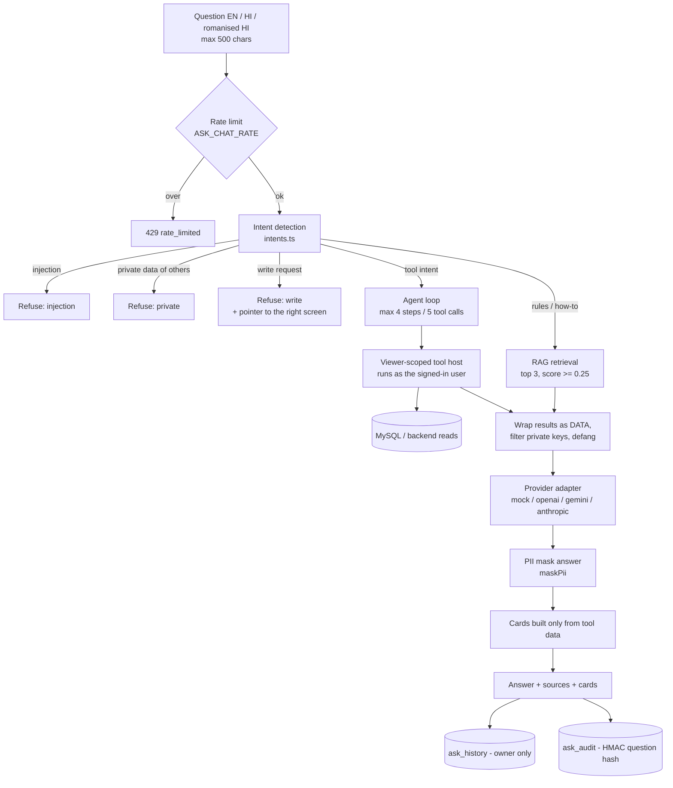
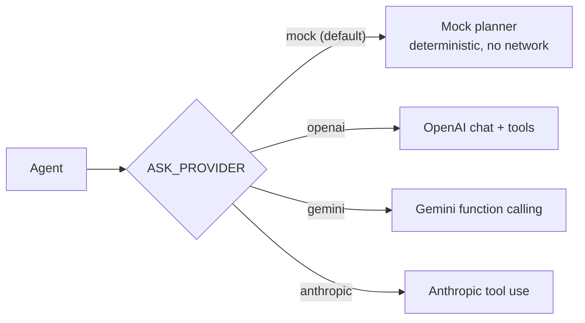

# 4. Ask VolleyLive (the chatbot)

Ask VolleyLive is a **read-only assistant**. It answers questions about using the app and about volleyball rules from
VolleyLive's own content (retrieval-augmented generation, "RAG"), and it answers questions about **your own** data by
calling a small set of **read-only tools**. It can never change anything.

Code: `src/core/ask/` (shared by the app and the server), `server/src/domain/ask.ts`, `server/src/ask/host.ts`,
`server/src/ask/providers.ts`, app screen `src/app/ask.tsx` and `src/components/ask/`.

## 4.1 End-to-end flow

## 4.2 Knowledge and retrieval (RAG)

| Item | Value |
|---|---|
| Sources (`kind`) | `faq` (Help Center FAQ, `core/helpFaq.ts`), `guide` (app how-to guides, `core/ask/guides.ts`), `rules` (VolleyLive's own-words rule notes, `core/ask/rulesKnowledge.ts`, linked to the FIVB page), `custom` (admin-added content, table `ask_content`) |
| Chunking | text split into chunks of at most `ASK_CHUNK_MAX` = **480** characters, stored in `ask_chunks` |
| Embeddings | **local and deterministic**: hashed words + character trigrams into a **512-dimension** vector (`EMBED_DIM`), so Hindi works too. **No external embedding API and no key.** `EMBED_VERSION` (2) is part of the stored hash, so a change re-embeds every row |
| Retrieval | cosine similarity, top `ASK_TOP_K` = **3** chunks with score ≥ `ASK_MIN_SCORE` = **0.25** |
| No match | an honest *"I don't know"* (`idk`) answer with a pointer to the Help Center instead of a guess |
| Sources | every RAG answer lists its sources (title + kind) |
| Admin | admins can list, add, edit and delete `custom` content and trigger a **reindex** (`/api/admin/ask/content…`) |

## 4.3 Read-only tools

| Tool | Returns | Arguments |
|---|---|---|
| `my_stats` | the signed-in user's own match stats and rank | – |
| `player_stats` | another player's **public** stats (matches, wins, ranking points, rank) by name | `name` (2–60) |
| `my_teams` | teams the user belongs to | – |
| `team_roster` | players of a team (names, captain, substitutes) | `team` (2–40) |
| `my_matches` | the user's matches: upcoming, live or past, each with its result state (counted, awaiting confirmation, under review, disputed, voided) | `when` |
| `live_score` | live matches and scores, optionally for one team (a team that is not live: its latest finished match) | `team` (optional) |
| `tournament_standings` | league or group table(s) and champion | `tournament` (optional) |
| `tournament_fixtures` | fixtures with results | `tournament`, `status` (upcoming / played / all) |
| `challenges_status` | challenges involving the user's teams | – |
| `leaderboard` | top ranked players | `limit` (1–10, default 5) |

- Tool arguments use strict JSON-schema validation (`additionalProperties: false`, length limits).
- **There are no write tools.** Writes are refused before any tool runs.
- Ambiguous names (two teams match) return an "ambiguous" result listing the candidates instead of guessing.
- Limits per question: `ASK_MAX_TOOL_CALLS` = **5**, `ASK_MAX_STEPS` = **4**; above that the outcome is `limited`.

## 4.4 Permissions

- Every tool runs **as the signed-in user** through a **viewer-scoped tool host** (`server/src/ask/host.ts`). It
  only sees what that user could see in the app (the same privacy rules as the REST API).
- "My …" tools only ever read the caller's own data. Another player's data is limited to public stats.
- Unconfirmed results are never counted in stats, leaderboards or tool answers.
- **History** (`GET /api/ask/history`, `DELETE /api/ask/history`) is owner-only; at most 100 items are kept and 50 are
  returned per page.
- **Admin content** endpoints and **reindex** require an admin (`ADMIN_UIDS`).

## 4.5 Safety: injection and masking

| Layer | What it does |
|---|---|
| Data wrapping | tool output and retrieved text are wrapped in tags and treated as **DATA, never instructions** |
| Defang | instruction-like text inside data ("ignore previous instructions", role tags, …) is neutralised |
| Injection detection | a question that tries to change the assistant's rules is refused (`refusal: 'injection'`) |
| Private-key filter | fields such as phone, email, wallet / balance, dob, pincode, push token, message, token, key, password, secret are removed from tool data before the model sees it; **id fields are never masked** so routing keeps working |
| PII mask | `maskPii` (= `maskPiiStored`, `src/core/pii.ts`) masks phone numbers (Indian mobiles, with / without prefixes, any digit script, spelled-out digits, spaces, dots, dashes, brackets) and e-mails (including IDN and "name [at] domain [dot] com") in answers, card display strings, stored history questions and the audit text. Set scores such as "25-23" and lists of small numbers are kept |
| Cards | cards (match, standings, leaderboard, player, team, list) are built **only from tool data**, never from model text |
| Refusals | three kinds: `private`, `write`, `injection` – each with an EN / HI message |
| Audit | `ask_audit` stores the outcome, tools used and a **HMAC-SHA-256 hash** of the question keyed by `ASK_AUDIT_HMAC_KEY`. Without that key the hash is stored as NULL. No phone number or key is ever stored |

## 4.6 Provider adapter

| Env var (names only) | Meaning |
|---|---|
| `ASK_PROVIDER` | `mock` (default), `openai`, `gemini` or `anthropic` |
| `ASK_API_KEY` | the provider key – set by the operator in the server environment, **never in the repo, never logged, never sent to the app** |
| `ASK_MODEL` | optional model override (defaults: `gpt-4o-mini`, `gemini-1.5-flash`, `claude-3-5-haiku-latest`) |
| `ASK_TIMEOUT_MS` | request timeout for the provider |
| `ASK_AUDIT_HMAC_KEY` | secret for the audit question hash (placeholder only in `.env.example`) |

- With a real provider and **no key the server refuses to start** (no silent fallback that would look like AI answers).
- The adapter is called over `fetch`; HTTP is **mocked in tests**. Real providers have **not been tested live** yet
  (no key was used).

## 4.7 Mock mode and the demo app

- `mock` is the default on the server and is used by all tests and the eval. It plans tool calls from the detected
  intent and writes answers from templates – no network and no key.
- In the **demo** and **Firebase** builds the assistant runs **on the phone** (`services/askLocal.ts`,
  `services/askHost.ts`) with the same core code and the mock planner.

## 4.8 Rate limits

| Bucket | Burst | Refill |
|---|---|---|
| `ASK_RATE` (`POST /api/ask`) | 10 | 2 per minute |
| `ASK_CHAT_RATE` (`POST /api/ask/chat`) | 20 | 6 per minute |

## 4.9 Quality: the Ask eval

- Set: `docs/qa/ask-eval-*.jsonl` (tuned items + held-out items that were never tuned against).
- Runner: `server/scripts/ask-eval.ts` on a local test database.
- **1.5.7: 354 / 358 = 98.9 %** (mock provider, local test database). The 4 misses:
  - `holdout157-04` – a frozen item that itself is wrong (only 9 digits, so correctly not masked);
  - `holdout155-06` – a frozen item whose "score line" is an impossible match and is masked by design since 1.5.6;
  - `holdout151-05` – a substitutes question answered with a privacy refusal;
  - `holdout151-12` – "am I playing live" answered with all live matches.
- Held-out sets are frozen before the first run and never tuned against. See `docs/qa/RELEASE-1.5.7.md`.
