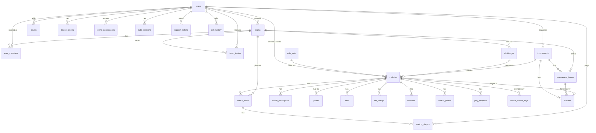

# 5. Database

VolleyLive has two persistent stores, one per online backend:

- **MySQL 8** for the API server – hand-written SQL migrations in `server/migrations/` (real foreign keys, CHECK
  constraints, generated columns, composite keys), queried with Knex.
- **Cloud Firestore + Cloud Storage** for the Firebase-direct build – protected by `firestore.rules` and
  `storage.rules`, with composite indexes in `firestore.indexes.json`.

The demo backend keeps the same shapes in memory and AsyncStorage on the phone.

The full generated ER diagram of the base schema is in [`docs/db-schema.mmd`](../db-schema.mmd) and
[`docs/db-schema.png`](../db-schema.png).

## 5.1 MySQL tables

| Table | Purpose | Added by |
|---|---|---|
| `users` | player profile (name, role, city, pincode, dob, avatar, admin flag via config); phone is private; normalised unique email | 0001, 0002, 0013, 0014 |
| `teams` | team name, colour, captain (`users`) | 0001 |
| `team_members` | team ↔ user membership (captain, substitutes) | 0001 |
| `team_invites` | pending invites by a captain to a user | 0001 |
| `rule_sets` | match rules (best of, points per set, deciding set, win by, cap, timeouts, side switches) | 0001 |
| `matches` | one match: status, rules, scorer, creator, tournament / challenge link, summary, POTM, captains, verification (pending / confirmed / disputed / approved / voided), abandon and lifecycle fields, progress sequence | 0001, 0004 – 0006, 0010, 0016 – 0018, 0023 |
| `match_sides` | the two sides (A / B) of a match, optionally a registered team | 0001 |
| `match_players` | the players of a side (registered users only) | 0001, 0002 |
| `match_participants` | everyone allowed to see / act on the match (players, creator, scorer) | 0001 |
| `points` | the rally log (one row per rally, credited player, shot kind) | 0001, 0003 |
| `sets` | derived set scores | 0001 |
| `set_lineups` | starting six / rotation per set | 0001 |
| `timeouts` | timeouts per set and side | 0001 |
| `match_photos` | photos of a match (storage key, uploader, content hash) | 0001, 0007 |
| `play_requests` | "want to play" requests for a match | 0001 |
| `challenges` | team-to-team challenges (from / to team and captain, rules, place, time, status, linked match) | 0001 |
| `tournaments` | tournament (organiser, format, rules, dates, venue, groups settings) | 0001, 0024 |
| `tournament_teams` | teams in a tournament (seed, group letter) | 0001, 0024 |
| `fixtures` | fixtures (home / away tournament team, round, group, seeds, linked match) | 0001, 0024 |
| `courts` | courts with location, surface, who added them | 0001 |
| `device_tokens` | push tokens per user / device | 0001 |
| `terms_acceptances` | which Terms version a user accepted, when | 0006 |
| `otp_challenges` | OTP requests (hashed code, attempts, expiry) | 0008 |
| `auth_sessions` | server sessions issued after OTP or Firebase exchange | 0008 |
| `feedback` | star rating + optional text | 0011 |
| `daily_items` | Fact / Quote of the day (with tombstones instead of deletes) | 0011, 0015 |
| `support_tickets` | Help Center tickets, screenshot key, replies, visibility | 0020, 0022 |
| `ask_chunks` | Ask RAG chunks and their local embeddings | 0021 |
| `match_create_keys` | idempotency keys for match creation | 0023 |
| `match_create_claims` | one-create claims (prevent double creation from retries) | 0025 |
| `ask_content` | admin-managed custom Ask content | 0026 |
| `ask_history` | per-user Ask history (masked question, answer, cards) | 0027 |
| `ask_audit` | Ask audit (outcome, tools, HMAC question hash) | 0027, 0028 |
| `schema_migrations` | applied migrations with sha256 checksums | runner |

Helper tables `email_duplicates_*` / `email_restored_*` are created only by the email repair migrations.

## 5.2 Relationships

## 5.3 Migrations

All migrations are **additive and re-runnable** (guarded with `IF NOT EXISTS` / information_schema checks).
The runner stores each file's **sha256** in `schema_migrations.checksum` and **refuses to start** if an applied file
changed (`MigrationChecksumError`). Never edit an applied migration – add a new one. A rollback script for 0024 is in
`server/src/db/rollback/rollback0024.ts`.

| # | File | Purpose |
|---|---|---|
| 0001 | `0001_init.sql` | base schema (21 tables) |
| 0002 | `0002_registered_players.sql` | match players must be registered users |
| 0003 | `0003_uncredit_removed_players.sql` | remove credits of removed players |
| 0004 | `0004_player_of_match_rankings.sql` | Player of the Match and rankings |
| 0005 | `0005_finished_needs_winner_photo_idempotency.sql` | finished needs a winner; photo idempotency |
| 0006 | `0006_terms_antifraud.sql` | terms acceptances; captains, server times and verification status |
| 0007 | `0007_photo_hash_signup_rows.sql` | photo content hash; sign-up rows |
| 0008 | `0008_otp_sessions.sql` | OTP challenges and auth sessions |
| 0009 | `0009_registration_team_size.sql` | registration team size |
| 0010 | `0010_captain_verdict.sql` | opposing captain verdict |
| 0011 | `0011_feedback_daily_items.sql` | feedback and daily items |
| 0012 | `0012_captain_verdict_backfill.sql` | backfill of captain verdicts |
| 0013 | `0013_users_email_unique.sql` | unique normalised email |
| 0014 | `0014_email_index_repair.sql` | email index repair (checksum allow-listed) |
| 0015 | `0015_daily_items_tombstones.sql` | daily item tombstones |
| 0016 | `0016_match_abandon.sql` | abandon fields (max events, was won, abandon info / request, resolution, scorer reassign) |
| 0017 | `0017_match_lifecycle.sql` | lifecycle epochs, abandon history and request counters |
| 0018 | `0018_verdict_repair.sql` | `matches.verdict_repair` (JSON) |
| 0019 | `0019_verdict_repair_type.sql` | check only: `verdict_repair` must be JSON |
| 0020 | `0020_support_tickets.sql` | support tickets |
| 0021 | `0021_ask_chunks.sql` | Ask RAG chunks |
| 0022 | `0022_support_message_visible.sql` | support message visibility |
| 0023 | `0023_match_create_keys_progress_seq.sql` | match create keys; `matches.progress_seq` |
| 0024 | `0024_tournament_groups.sql` | groups + knockout (advance, group letters, seeds) |
| 0025 | `0025_match_create_claims.sql` | match create claims |
| 0026 | `0026_ask_content.sql` | Ask admin content |
| 0027 | `0027_ask_history_audit.sql` | Ask history and audit |
| 0028 | `0028_ask_audit_hmac.sql` | HMAC question hash in the audit |

> **Production status:** nothing has been deployed. Migrations **0024 – 0028 are pending production approval**.
> Back up the database before migrating (see `docs/DEPLOY.md`).

## 5.4 Firestore collections (Firebase build)

| Collection | Contents |
|---|---|
| `users/{uid}` | public profile; `users/{uid}/private/*` holds private fields (phone, dob, pincode, review state) readable only by the owner |
| `phoneIndex/{phone}` | phone → uid look-up for adding players (rules-restricted) |
| `emails/{address}` | email uniqueness claims |
| `teams/{id}` | team, members, invites |
| `matches/{id}` | match document (rules, sides, players, events, summary, verification, abandon / lifecycle fields); subcollections `photos` and `photoMeta` |
| `challenges/{id}` | challenges |
| `tournaments/{id}` | tournaments and fixtures |
| `courts/{id}` | courts |
| `dailyItems/{id}` | Fact / Quote of the day (tombstoned, never deleted) |
| `feedback/{id}` | feedback |
| `supportTickets/{id}` | support tickets |
| `pushTokens/{uid}` | push tokens |
| `terms/{uid}` | terms acceptance |

Storage holds match photos and avatars (images only, size-limited by `storage.rules`).
A composite index on `matches` (`verification.status` + `finishedServerAt`) is required for rankings.
