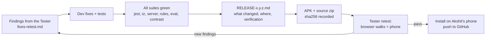

# 8. Testing and QA

## 8.1 Test suites

| Suite | Where | What it covers | Run |
|---|---|---|---|
| **App unit / component tests** | `src/**/__tests__` (Jest, 173 suites) | core logic (scoring, rotation, rules, lifecycle, anti-fraud, ranking, POTM, tournaments, groups, PII, Ask agent / tools / intents), backends (demo, API client, Firebase docs), components and screens (Day / Night, EN / HI, 360 px), theme resolve and transition, i18n parity | `npm test` |
| **Time-zone run** | same tests | the whole Jest suite under 5 zones: UTC, Asia/Kolkata, Asia/Colombo, America/Los_Angeles, Pacific/Kiritimati (IST day / week limits, greetings, theme hours) | `npm run test:tz` |
| **Typecheck** | app and server | TypeScript strict checks | `npx tsc --noEmit`, `cd server && npm run typecheck` |
| **Server API tests** | `server/tests/*.test.ts` (`node --test`) | every route, auth modes, rate limits, terms gate, transactions and races, migrations and checksums, Ask host / providers (mocked HTTP), audit HMAC, WebSocket | `cd server && TEST_DATABASE_URL=… npm test` (database name must end in `_test`; all tables are dropped) |
| **Firestore / Storage rules tests** | `rules-tests/rules.test.js` | the security rules against the Firebase emulator; agreement with `src/core` | `cd rules-tests && npm test` (Firebase emulator) |
| **Abandon policy suites** | `scripts/run-policy-suites.sh` | the abandon-related suites under each policy (`review`, `flag`, `consent`), then restores `review` | `bash scripts/run-policy-suites.sh` |
| **Ask eval** | `server/scripts/ask-eval.ts`, `docs/qa/ask-eval-*.jsonl` | answer / card / refusal correctness on tuned and frozen held-out questions (mock provider, local test DB) | see the script header |
| **Contrast scan** | `scripts/contrast/scan.js` | renders every route, modal and state in Day / Night × EN / HI on the web build and checks each visible text against WCAG AA (4.5:1, 3:1 large) | `BASE=http://127.0.0.1:8099 node scripts/contrast/scan.js` |
| **Demo strip check** | `scripts/check-strip.js` | a production web export contains no demo code | `npm run check:strip` after `npx expo export -p web` |

## 8.2 Latest results (1.5.7, versionCode 52)

| Check | Result |
|---|---|
| Jest | **2514 / 2514** passed, 173 suites |
| Jest in 5 time zones | passed |
| Server | **560 / 560** |
| Rules | **226 / 226** |
| Ask eval | **354 / 358 (98.9 %)** – 4 known misses, see [04](04-chatbot.md#49-quality-the-ask-eval) |
| Contrast | **268** text pairs checked, **0** failures |

Earlier builds' results are in `docs/qa/RELEASE-<version>.md` and `docs/qa/PROGRESS-<version>.md`.

## 8.3 QA process

1. **Findings** – the Tester runs full end-to-end walks (web build at 360 px, Day / Night, EN / HI) and writes
   numbered findings with severity (High / Medium / Low), e.g. `F156-1`.
2. **Fixes** – each finding gets a fix and a test that would have caught it; release notes map finding → change →
   test.
3. **Verification** – all suites above; screenshots before / after for visual fixes.
4. **Build** – APK and source zip with recorded sha256; same signing certificate between builds.
5. **Retest** – the Tester retests every finding and adds new held-out Ask items (frozen before the first run).
6. **Ship** – install on the test phone (`adb install -r`, never uninstall or downgrade) and push the source to GitHub
   (normal push, secret scan before commit).

## 8.4 Rules for test data

- Test and screenshot data must be **sample data** (made-up names). No real phone numbers or personal data in tests,
  fixtures, screenshots or the eval set.
- Server tests refuse to run unless the database name ends in `_test`.
- Ask tests and the eval use the **mock** provider only; no keys are used.
