# 11. Design system

This chapter is the design reference for VolleyLive: colours, type, spacing, components, the Day / Night logic,
screen notes, the logo history and the icon specifications. The **source of truth for 1.5.7 is the code**
(`src/theme/tokens.ts`, `src/theme/themes.ts`, `src/theme/resolve.ts`, `src/theme/ThemeTransition.tsx`). Design
sources: `volleylive-design/daynight/daynight-spec.md` (spec v2), `volleylive-design/directions/`,
`volleylive-design/logo/` and `volleylive-design/logo/v2/final-bold-spiker/`. All mockups use **sample data**.

## 11.1 Design history in one page

| When | Step | Outcome |
|---|---|---|
| 11 Oct 2026 | Phase-2 "Navy Live" spec (`design-spec.md`) – Paytm-style navy `#002E6E` + light blue `#00BAF2`, system fonts, Ionicons | superseded |
| Oct 2026 | Two directions explored: **A · Floodlight** (stadium night) and **B · Sunday Court** (court day) | both kept – as the Night and Day themes |
| 1.4.22 | **Day / Night spec v2** – one component library, two token sets, time-based switching, greeting states, Sunset → Floodlight transition | core screens rebuilt |
| 1.4.25 | **Brighter palette** – Akshit: "the colour is too much dark, make it brighter" | current tokens below |
| 13 Oct → 1.4.26 | Logo concepts 1 – 10 → **7 · Spiker** chosen | ships in 1.5.7 |
| 29 Oct | Logo v2 – six options → Akshit chose the **Bold Spiker** | kit ready for 1.5.8 |
| proposal | **Greens update** (Night primary `#9BFF3A` …) | not in 1.5.7 |

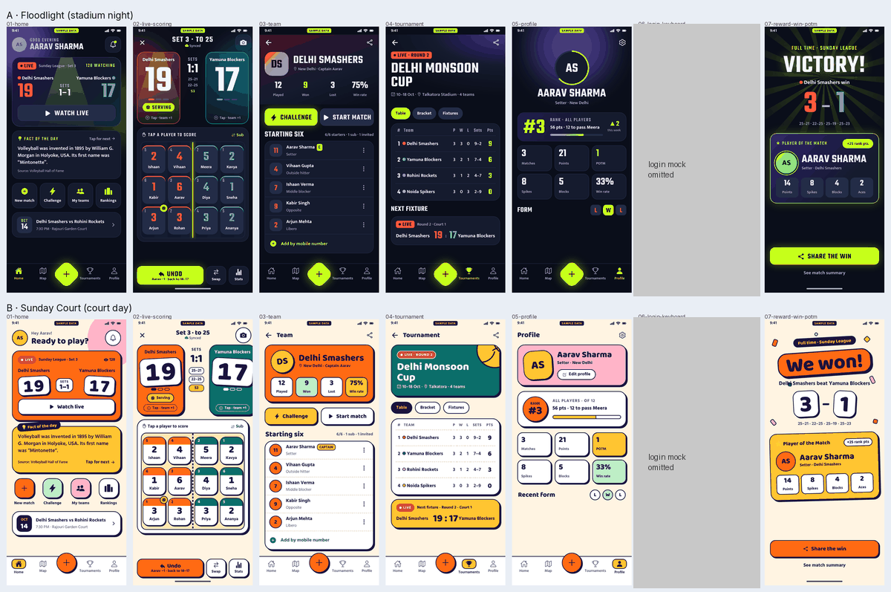

*Directions A and B side by side (the login mock column is blanked out in this copy).*

## 11.2 Colour palette (1.5.7 tokens)

| Token | Day · "Sunday Court" | Night · "Floodlight" | Use |
|---|---|---|---|
| `bg` | `#FFFAF3` | `#1E2A44` | screen background |
| `surface` | `#FFFFFF` | `#283654` | cards, sheets |
| `surface2` | `#FFF5E6` | `#33446A` | secondary surfaces, skeletons |
| `outline` | `#6B6590` | `#7A8BB8` | card borders, dividers |
| `text` | `#2A2452` | `#F4F7FF` | primary text ("ink") |
| `textMuted` | `#5E5779` | `#C3CDE3` | secondary text |
| `primary` | `#FF6A13` (Court orange) | `#C6FF1A` (Volt) | primary buttons, FAB, highlights |
| `onPrimary` | `#2A2452` | `#141C30` | text on primary |
| `accent` | `#FFC531` (Ball yellow) | `#8B6CFF` (Ultra) | stickers, selections (Night: gradients / glow only, never text) |
| `teamA` | `#FF6A13` | `#FF6B70` | team A fill |
| `teamAText` | `#B4460A` | `#FF9A9E` | team A text / orange text |
| `teamB` | `#0B6E6A` | `#2DD4F0` | team B fill |
| `onTeamB` | `#FFFFFF` | `#141C30` | text on team B |
| `live` | `#C81E3A` | `#FF4D6A` | LIVE badge, errors |
| `onLive` | `#FFFFFF` | `#141C30` | text on live |
| `liveText` | `#C81E3A` | `#FFA3B1` | live / error text |
| `success` | `#BDEFD8` | `#C6FF1A` | success chips |
| `tabActive` | `#2A2452` | `#C6FF1A` | active tab |
| `pink` | `#FFB4C8` | `#33446A` | Day decor blob |
| `track` | `#F1E8DA` | `#3A4A70` | progress tracks |
| `hero` gradient | `#FF6A13` (solid) | `#3A3478` → `#283654` → `#1F4A5A` | live hero card |
| `scrim` | `rgba(42,36,82,0.45)` | `rgba(10,16,32,0.60)` | modal scrim |
| `tabBarBg` | `rgba(255,250,243,0.94)` | `rgba(30,42,68,0.94)` | tab bar |
| `shadowColor` | `rgba(42,36,82,0.20)` | transparent | Day hard shadow |

**Contrast rules** (spec v2, re-checked by the contrast scan – 268 pairs, 0 failures in 1.5.7):

- every text pair passes **WCAG AA 4.5:1** in both themes (e.g. `text` on `bg` 15.89:1 Day / 17.97:1 Night);
- Day `primary` orange is a **fill** colour; orange **text** uses `teamAText` `#B4460A`; never white on Court orange (2.9:1);
- Night `accent` is for gradients and glow only;
- dark team colours get a light ring in Night (`swatchRing`) when below 3:1 on the card.

The older map in `themes.ts` (`SUNDAY_COURT` / `FLOODLIGHT`) keeps a few legacy names for older components, such as
`gold` (`#FFC531` / `#FFC727`) and `danger` (`#C81E3A` / `#FF9AA2`).

**Greens update (proposal, not shipped):** `daynight/green/greens-update.md` proposes a brighter Night green
(`#9BFF3A` as primary) and matching success / tab tokens. It needs Akshit's go-ahead and a contrast re-run.

## 11.3 Typography

| Role | Day | Night |
|---|---|---|
| Display (titles, hero) | **Baloo 2 ExtraBold** (800), Latin + Devanagari | **Teko SemiBold** (600), UPPERCASE Latin |
| Display in Hindi | Baloo 2 ExtraBold | **Mukta ExtraBold** (800), sentence case, no letter-spacing (Teko has no Devanagari) |
| Score numerals | Baloo 2 ExtraBold on a tilted white sticker | Teko SemiBold, tabular, in team colour (also in Hindi) |
| Body | **Hind** Regular / SemiBold / Bold | **Mukta** Regular / Bold |

Greeting header: greeting 14, name 26 – 28 (one line, ellipsis). Scoreboard numerals 54 – 112.
Font licences: `docs/FONT-LICENSES.md` (all SIL OFL).

## 11.4 Spacing, sizes, radius, elevation

| Token | Value |
|---|---|
| Spacing grid | **4-pt**: 4 · 8 · 12 · 16 · 20 · 24 · 32; screen padding **16** |
| Button | height **52**, icon 20 + label, full width or hug ≥ 120 |
| Input | height **56**, label above, helper / error below |
| Chip | **36** visual (44 in forms), hit area **48** |
| Icon button | **48 × 48**, icon 22 – 24 |
| Tab bar | tab **64 × 56**, bar height 88 incl. 24 gesture inset, 4 tabs + centre FAB **60** |
| List rows / sheet rows | **≥ 64** |
| Radius card / button / chip | Day **22 / 16 / 18** · Night **20 / 14 / 18** |
| Card border | Day **2 px** `outline` · Night **1 px** `outline` |
| Shadow | Day: hard offset **3 / 3**, ink at 20 %, drawn as a View (elevation 0) · Night: none; glow `rgba(198,255,26,0.35)` on primary only |
| Touch targets | ≥ 48 dp everywhere |
| Motion – point | Day "Stamp": scale 1.15 → 1, rotate ±6°, spring · Night "Flash": beam sweep 280 ms, +1 pop in Volt |
| Decor | Day: blobs, rotated stickers, confetti · Night: glow blobs, floodlight beam |

## 11.5 Components

| Component | Anatomy / size | States | Day vs Night |
|---|---|---|---|
| Button (primary / secondary / text) | h52 | rest, pressed (scale .97), disabled (solid muted colours), loading | Day ink border + hard shadow; Night glow on primary |
| Icon button | 48 × 48 | rest / pressed / badge dot 8 | Day circle with border; Night rounded-16 surface |
| Chip / filter | h36, hit 48 | off / on / disabled | on: Day ink + Ball text; Night Volt + ink |
| Segmented control | h52, items h42 – 44 | selected / unselected | selected: Day ink + Ball; Night Volt + ink |
| Card | radius card, padding 14 – 16 | rest / pressed (.98) / highlighted | border + shadow tokens |
| Text input | h56 | rest / focus / error (live colour + icon + text) / disabled | focus: Day orange offset shadow; Night 2 px Volt + glow |
| OTP cells | 6 × 46 × 58 | empty / focus / filled / error shake 240 ms | as input |
| Stepper | dots 10, active 28 wide, "Step n of N" | done / current / todo | – |
| List row | ≥ 64, leading 40 – 44 | rest / pressed / unread | dividers: Day dashed, Night solid |
| Tab bar | 4 tabs + centre FAB | active / inactive | Day Ball pill; Night Volt label |
| Live badge | h22 – 24, dot 7 pulsing 1.2 s (static with Reduce Motion) | – | – |
| Player chip (scoring) | min 96 × 64: number, name, points, position badge | rest / pressed / serving / disabled | – |
| Team panel (scoring) | half width, min-h 214, "Tap · team +1" hint | rest / pressed / serving | Day sticker panel; Night side-colour border / glow |
| Radio option card | min-h 76, thumb 44 × 52, radio 26 | selected / unselected | Day Ball fill; Night Volt border |
| Switch | 52 × 32 | on / off / disabled | – |
| Bottom sheet | radius 24 top, grabber, rows ≥ 64, Cancel 52 | open / dragging | scrim: Day ink 55 %; Night black 72 % |
| Toast (Undo) | h56, 8 above the tab bar | 4 s auto-dismiss / action | – |
| Empty / error state | art 120 – 180, title, body, primary + text link | offline / server / permission | art recoloured by tokens |
| Skeleton | `surface2` blocks | shimmer 1.2 s (static with Reduce Motion) | – |
| Greeting header | art 52, greeting 14, name 26 – 28, bell 48 | 4 variants | see 11.6 |
| Reaction button (viewer) | 48 circle, emoji 22 | rest / pressed / sent | UI only in 1.5.7 |

Kit components live in `src/components/DayNightKit.tsx`, `DNKit.tsx` and `ui.tsx`.

## 11.6 Day / Night logic and the greeting

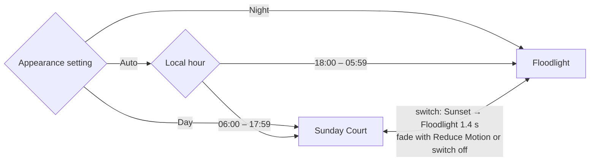

- **Auto is time-based only** in 1.5.7 (Akshit's choice). Spec v2 said the phone's dark mode should win; the code
  deliberately does not follow that.
- The appearance screen shows *"Now showing … – switches to Night at 6:00 PM"*.
- **Live screens hold the switch**: the scorer screen calls `holdTransitions(true)`; a switch that fires during a
  rally is stored as pending and applied after the next point as a **400 ms crossfade**. Taps are never blocked.
- The full animation plays **once per switch**.

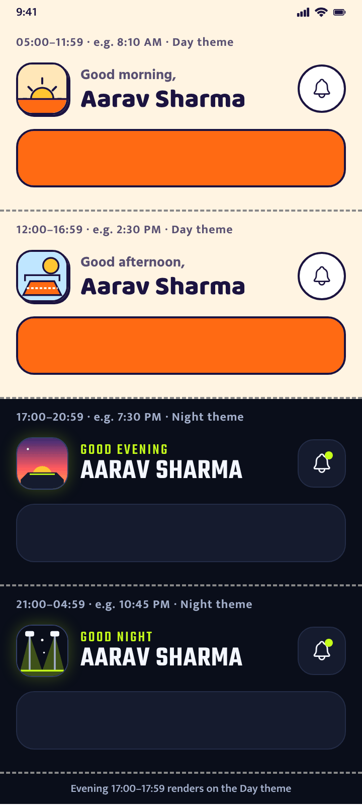

| Greeting | Hours | English text |
|---|---|---|
| Morning | 05:00 – 11:59 | "Good morning, {name}" |
| Afternoon | 12:00 – 16:59 | "Good afternoon, {name}" |
| Evening | 17:00 – 20:59 | "Good evening, {name}" |
| Night | 21:00 – 04:59 | "Late game, {name}?" |

`{name}` is the first word of the display name; without a name the bare form is used ("Good morning", "Late game?"). The greeting refreshes at every minute boundary (`src/theme/resolve.ts`).
The greeting hours are separate from the theme hours (e.g. 17:00 is "Good evening" in the Day theme).

### Sunset → Floodlight transition

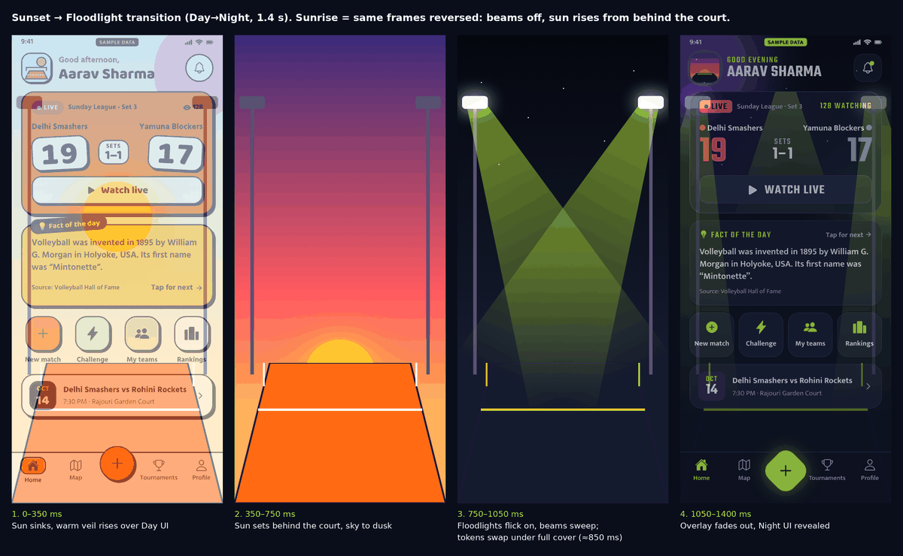

| t (ms) | Day → Night |
|---|---|
| 0 – 350 | veil fades in over the Day UI; the sun starts to sink |
| 350 – 750 | sky goes day → dusk; the sun sinks behind the court; the overlay covers the screen by 700 |
| 750 – 1050 | lamps flicker on; beams sweep; **at 850 ms the tokens are swapped underneath** |
| 1050 – 1400 | beams settle; the overlay fades out, revealing Night |

Sunrise plays the same timeline in reverse. Everything runs on the UI thread (reanimated); haptic *Light* when the
lights come on; screen readers hear "Night theme on".

## 11.7 Screens in both themes

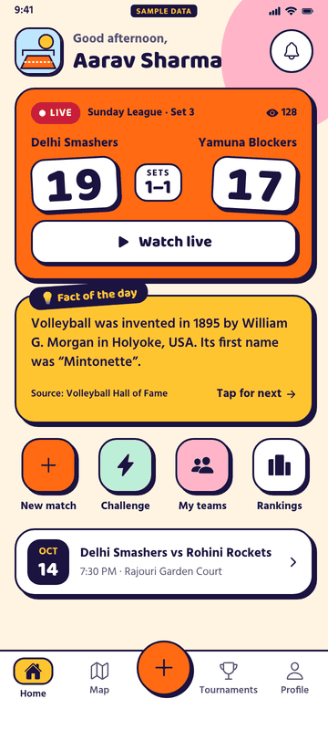
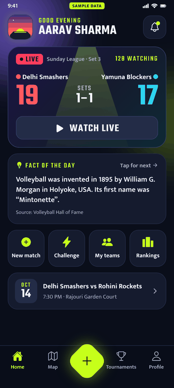
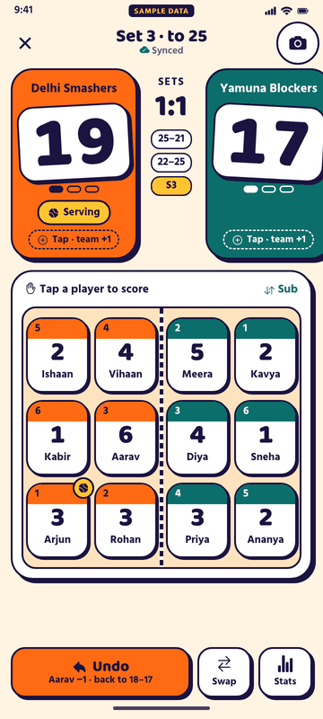
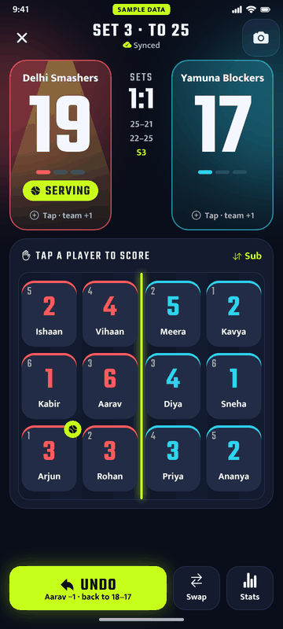

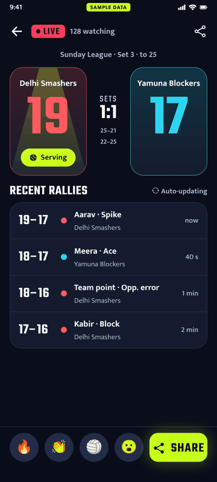
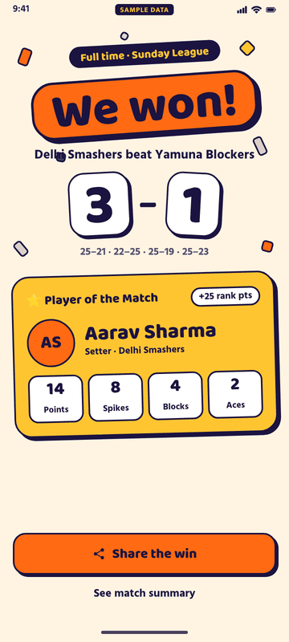
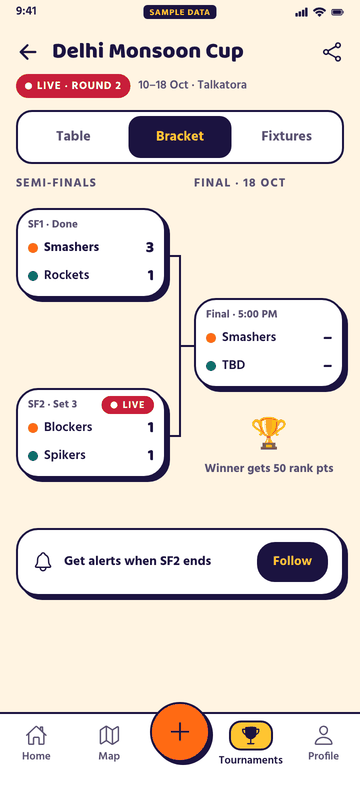
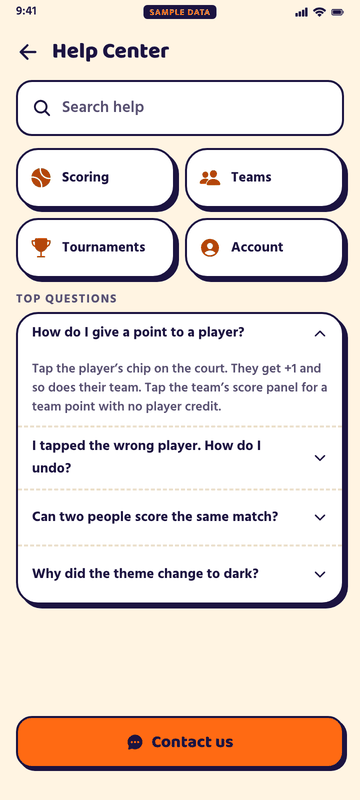

App screenshots (1.4.24 – 1.4.26 builds, demo data):

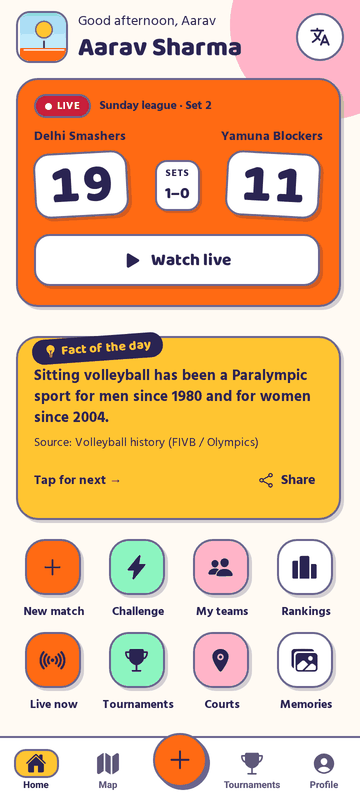
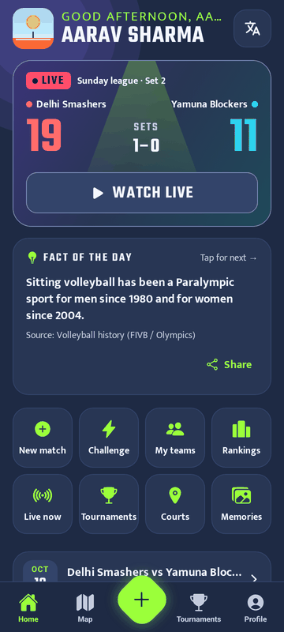
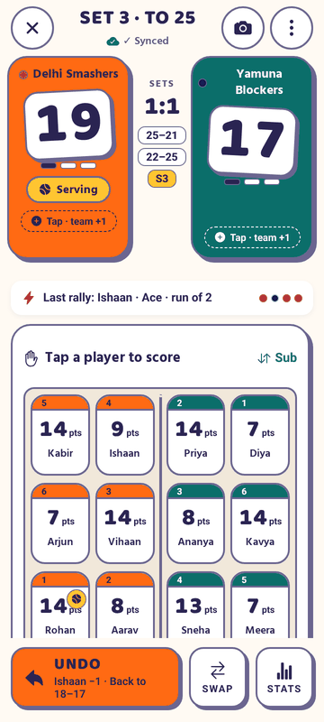
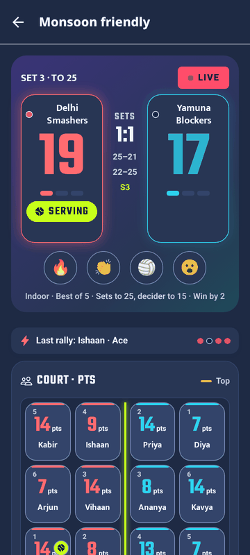
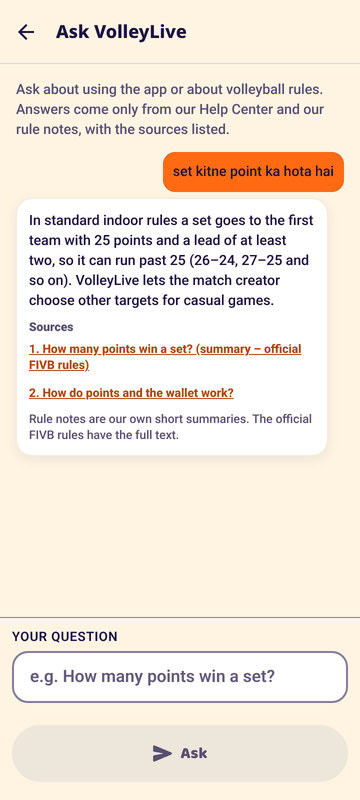
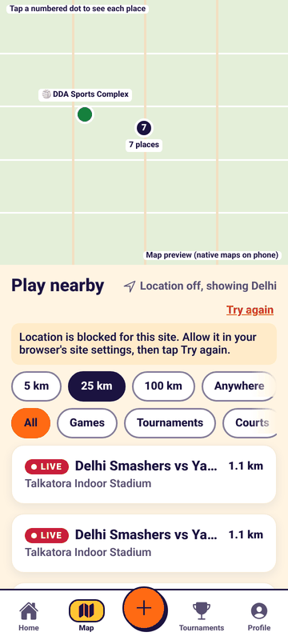

## 11.8 Screen-by-screen design notes

General rules: scroll content gets bottom padding = tab bar (88) + 16 or docked button + 48; input screens keep the
primary button **above the keyboard**; one primary action per screen; 48 dp targets; Hindi may wrap to 2 lines but is
never truncated in buttons.

| # | Screen | Primary action | Notes | In 1.5.7? |
|---|---|---|---|---|
| 1 | Onboarding (3 swipes) | Get started | skip, page dots, "Log in" link | not built |
| 2 | Login (+91 number) | Send OTP | field and button stay above the keyboard; language switch | yes |
| 3 | OTP | Verify (disabled until 6 digits) | 6 cells, resend timer, change number | yes |
| 4 | Profile setup | Let's play | photo (optional), name, role chips, city, DOB picker | yes |
| 5 | Home | Watch live (+ FAB New match) | greeting header, live hero, fact card, quick actions, upcoming | yes |
| 6 | Teams list | Create team | search, rows ≥ 64, captain tag | yes |
| 7 | Team detail | Challenge | stats, roster, add by mobile number | yes |
| 8 | Create team | Save team | name, colour (6 swatches × 48), players by number | yes |
| 9 | New match flow | Next | spec: 4 steps with shirt numbers; **app: 3 steps (Teams → Rules → Start)** | changed |
| 10 | Live scoring | tap player = player +1 & team +1; tap panel = team +1 | sticky Undo, camera, serving, sets won | yes |
| 11 | Live viewer | Share | read-only scoreboard, recent rallies, reactions (UI only) | yes |
| 12 | Match summary / POTM / win | Share the win | Day confetti stickers / Night ray burst | yes |
| 13 | Photos sheet | Take photo | Take photo, Gallery, Cancel | yes |
| 14 | Tournaments list | New tournament | live / upcoming / finished cards | yes |
| 15 | Tournament detail | Follow | segmented Table / Bracket / Fixtures | yes |
| 16 | Rankings | – | spec: Players / Teams, period chips, podium, pinned own row | partly |
| 17 | Profile | Edit profile | rank card, stats grid, form; Settings → Appearance | yes |
| 18 | Appearance | (selection saves) | Auto / Day / Night radio cards + animation switch | yes |
| 19 | Help Center | Contact us | search, topic tiles, FAQ accordion | yes |
| 20 | Notifications | Mark all read | Today / Earlier, inline Accept / Decline | not built (push + Home cards instead) |
| 21 | Empty / loading / error | Create / – / Try again | empty hero, Home skeleton, offline / server / permission | partly |

## 11.9 Logo history

### v1 – ten concepts (13 Oct 2026)

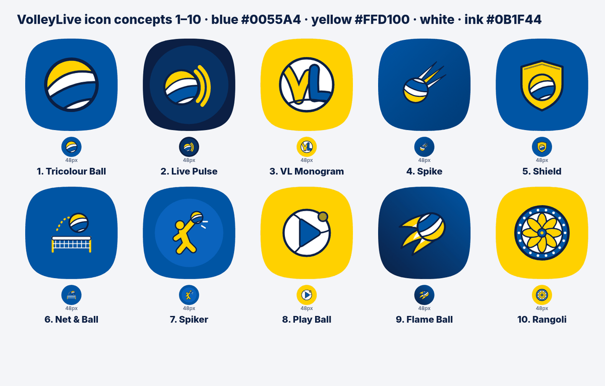

The first four concepts used the palette **blue `#0055A4`, yellow `#FFD100`, ink `#0B1F44`**: 1 Tricolour Ball,
2 Live Pulse, 3 VL Monogram, 4 Spike (the first recommendation was the Tricolour Ball). Six more were added:
5 Shield, 6 Net, **7 Spiker**, 8 Play Ball, 9 Flame, 10 Rangoli.

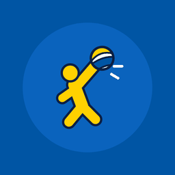

**7 · Spiker was chosen** ("final-spiker"). It is the icon that ships in 1.5.7 (`assets/icon.png`, adaptive
background `#0055A4`, monochrome layer, Day / Night splash, white notification icon).

### v2 – six refreshed options (29 Oct 2026)

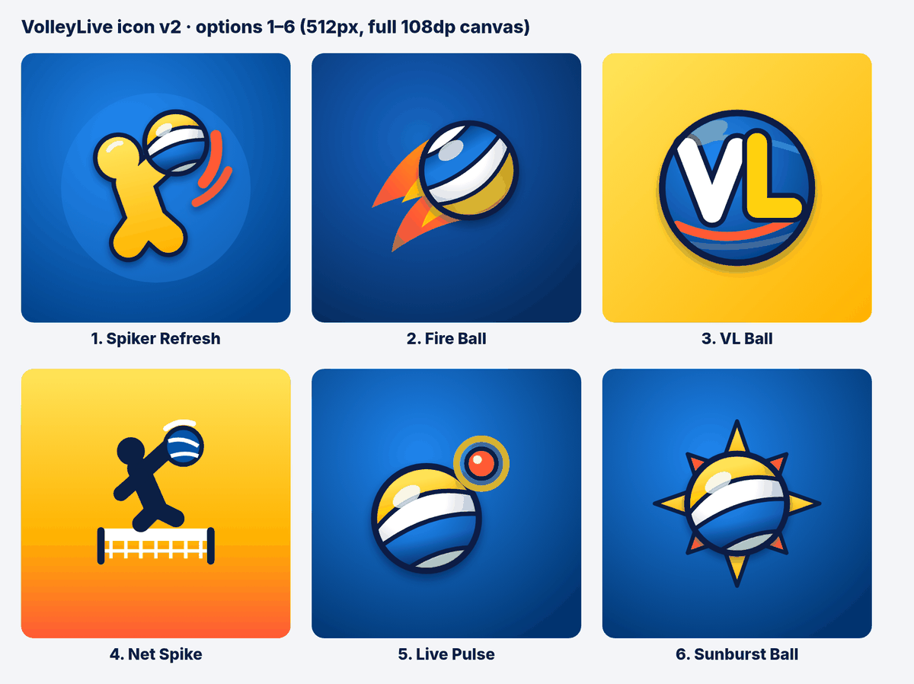

1 Spiker Refresh, 2 Fire Ball, 3 VL Ball, 4 Net Spike, 5 Live Pulse, 6 Sunburst. At 24 px, VL Ball and Spiker read
best. **Top pick: Spiker Refresh** – "the most ownable idea (a person playing, not just a ball)", the strongest colour
mass at 48 px, and it keeps the Spiker Akshit liked.

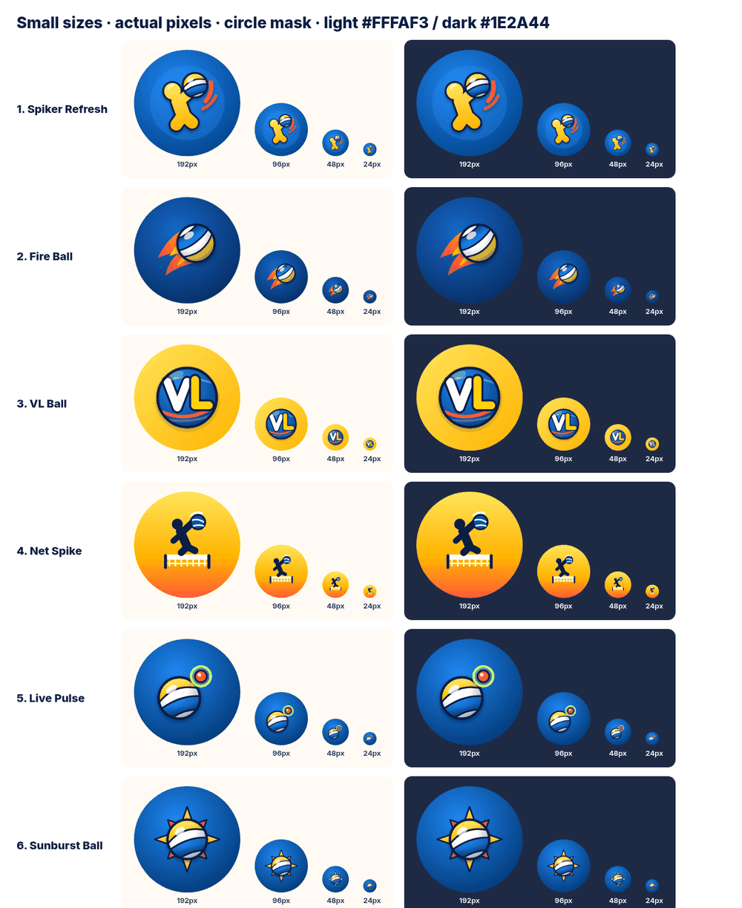

### Final – the Bold Spiker (chosen, for build 1.5.8)

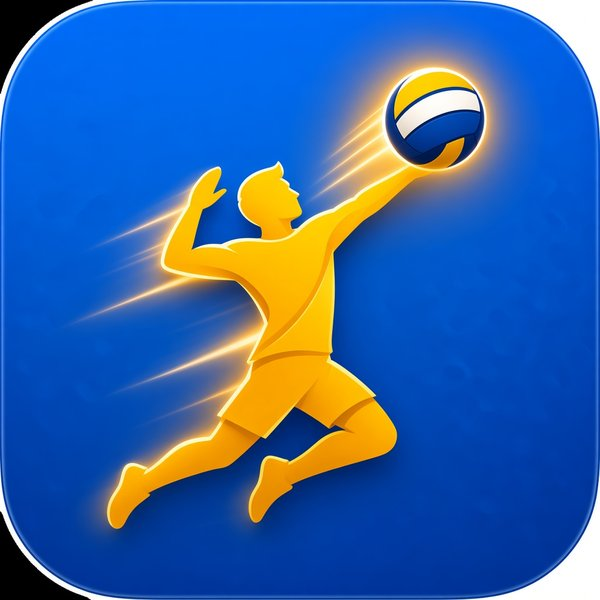
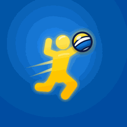
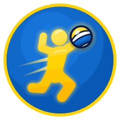
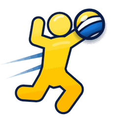
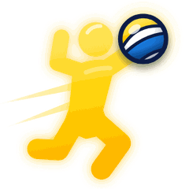

Akshit then chose a bolder version: *a big glowing yellow athlete spiking a blue / yellow / white ball, with motion
streaks, on a blue radial gradient* – original vector artwork based on the chosen concept image. The full kit is in
`volleylive-design/logo/v2/final-bold-spiker/`. **It is not in 1.5.7**; adopting it is a file swap plus a native
rebuild (`expo prebuild`) in 1.5.8.

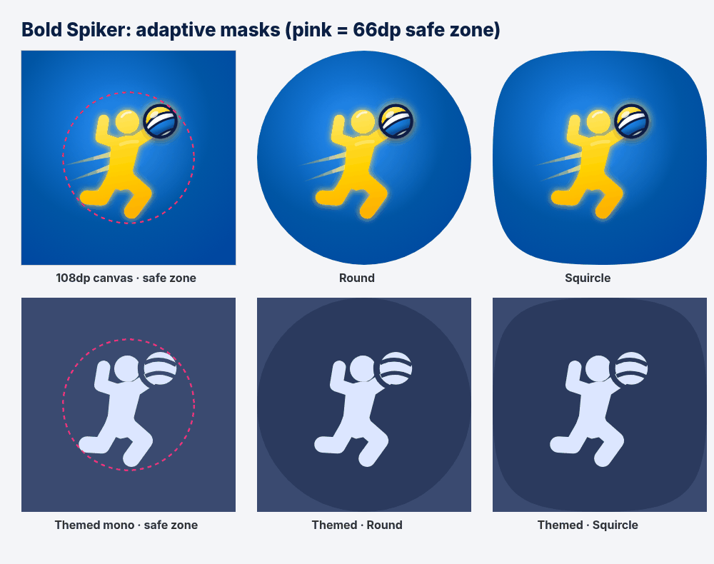
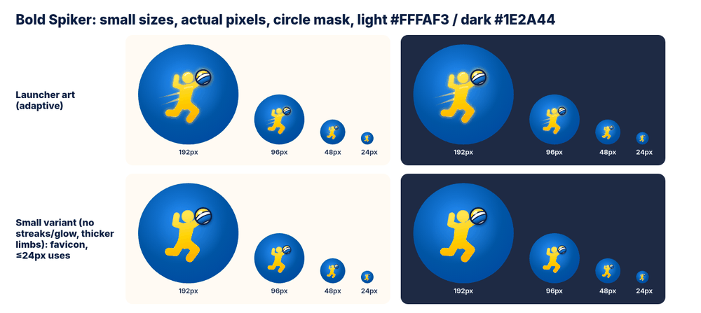

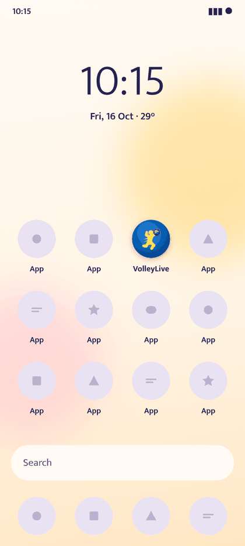
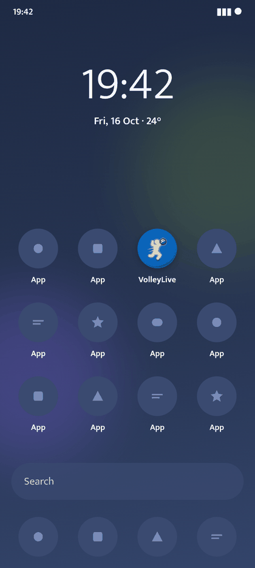
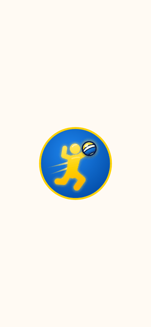
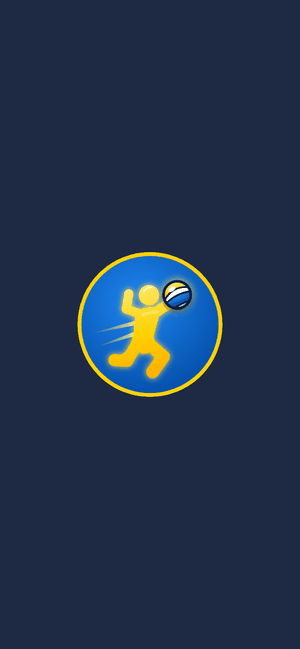

## 11.10 Icon specifications (Bold Spiker)

### Geometry

- **Adaptive canvas 108 × 108 dp**; **safe zone: 66 dp circle** → **21 dp padding per side (19.44 %)**.
- Key art (figure + ball, glow excluded) fits within a 33.1 dp radius; only faded streak tips and glow pass the safe
  zone (checked under round and squircle masks).
- Monochrome layer: same geometry. Notification icon: silhouette cropped to a 62 dp viewBox (~85 % of the 24 dp grid).
- Small variant (favicon): no streaks or glow, limbs 1.4 dp thicker, for 16 – 32 px.

### Colours

| Use | Hex |
|---|---|
| Brand blue (adaptive `backgroundColor`, notification `color`) | `#0055A4` |
| Background gradient highlight / mid / edge | `#1E86F0` / `#0055A4` / `#0047A0` |
| Background glow | `#3FA0FF` 45 % → 0 % |
| Figure gradient top / mid / bottom | `#FFE45A` / `#FFD100` / `#FFB300` |
| Figure glow | `#FFD54A` |
| Streaks | `#FFF3B0` → `#FFD100` → 0 % (Day logo mark `#0055A4` → 0 %) |
| Ball panels | yellow `#FFE45A` → `#FFC400`, blue `#1A7BE0` → `#003F86`, white `#FFFFFF` |
| Ink outline | `#0B1F44` |
| Badge ring | `#FFD100` |
| Splash background Day / Night | `#FFFAF3` / `#1E2A44` |
| Monochrome and notification | `#FFFFFF` on transparent (system-tinted) |

### Files and sizes

| Asset | Files | Size / format |
|---|---|---|
| Adaptive foreground | `adaptive/foreground-1024.png`, `foreground-432.png`, `adaptive-foreground.svg` | 1024 / 432 px, transparent |
| Adaptive background | `adaptive/background-1024.png`, `background-432.png`, `adaptive-background.svg` | gradient image (or the single colour `#0055A4`) |
| Legacy icon | `legacy/icon.png` | 1024 px, RGB, no alpha |
| **Play Store icon** | `legacy/play-store-512.png` | **512 × 512**, 32-bit RGBA, fully opaque, full square, no rounding |
| Monochrome (Android 13 themed) | `monochrome/monochrome-1024.png`, `-432.png`, `.svg` | white on transparent |
| Splash | `splash/splash-icon.png` (+ Day / Night previews) | 1024 px transparent badge; `imageWidth` 200 |
| Notification | `notification/notification-icon-96.png`, `notification.svg`, `drawable-mdpi` 24 · `hdpi` 36 · `xhdpi` 48 · `xxhdpi` 72 · `xxxhdpi` 96 (`ic_notification.png`) | white on transparent |
| Favicon | `favicon/favicon.ico` (16 / 32 / 48), `favicon-16/32/48.png` | small variant |
| In-app logo | `logo/logo-badge`, `logo-mark-day`, `logo-mark-night` – `.svg`, `.png` 120, `@2x` 240, `@3x` 360 | badge / marks |

### `app.config.ts` keys for 1.5.8

| Key | Value |
|---|---|
| `android.adaptiveIcon.foregroundImage` / `backgroundImage` / `monochromeImage` | the adaptive / monochrome files above |
| `android.adaptiveIcon.backgroundColor` | `#0055A4` |
| `expo-splash-screen` | `image` = splash icon, `imageWidth` 200, `backgroundColor` `#FFFAF3`, dark `#1E2A44` |
| `expo-notifications` | `icon` = notification icon, `color` `#0055A4` |
| `icon` | `legacy/icon.png` |
| `web.favicon` | `favicon/favicon-48.png` copied to `assets/favicon.png` (optional `favicon.ico` in `public/`) |

Integration steps are in `final-bold-spiker/INTEGRATION.md`.
